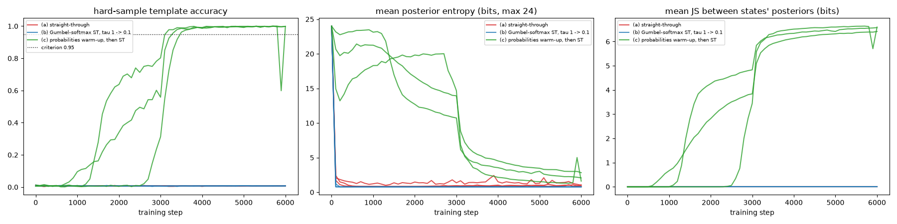
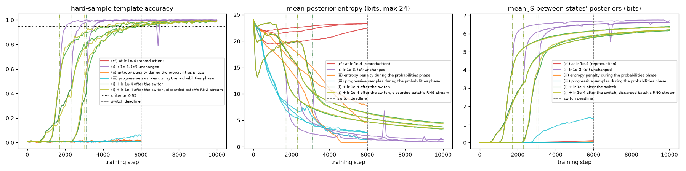

# E3 -- estimator comparison (autoencoder isolation, no KL)

k=6, 6000 steps, lr 0.001, batch 32, seeds [0, 1, 2]. Schedules fixed before the runs: (b) tau 1 -> 0.1 exponentially over the first 3000 steps, then held; (c) posterior probabilities for the first 3000 steps, then plain straight-through. Evaluation: discrete forward pass with a hard one-hot sample, template accuracy averaged over 5 draws. Criterion (fixed in advance): >= 0.95 on all 3 seeds.

| estimator | seed | hard-sample acc. | mode acc. | posterior entropy (bits) | mean JS between states (bits) | pass |
|---|---|---|---|---|---|---|
| (a) straight-through | 0 | 0.0069 | 0.0069 | 1.06 | 0.000 | no |
| (a) straight-through | 1 | 0.0069 | 0.0069 | 1.00 | 0.000 | no |
| (a) straight-through | 2 | 0.0083 | 0.0069 | 0.86 | 0.000 | no |
| (b) Gumbel-softmax ST, tau 1 -> 0.1 | 0 | 0.0069 | 0.0069 | 0.78 | 0.000 | no |
| (b) Gumbel-softmax ST, tau 1 -> 0.1 | 1 | 0.0069 | 0.0069 | 0.78 | 0.000 | no |
| (b) Gumbel-softmax ST, tau 1 -> 0.1 | 2 | 0.0083 | 0.0069 | 0.78 | 0.000 | no |
| (c) probabilities warm-up, then ST | 0 | 0.9986 | 1.0000 | 2.82 | 6.416 | yes |
| (c) probabilities warm-up, then ST | 1 | 0.9986 | 1.0000 | 2.07 | 6.577 | yes |
| (c) probabilities warm-up, then ST | 2 | 0.9944 | 1.0000 | 1.60 | 6.596 | yes |

| estimator | passes on all 3 seeds |
|---|---|
| (a) straight-through | no |
| (b) Gumbel-softmax ST, tau 1 -> 0.1 | no |
| (c) probabilities warm-up, then ST | yes |

**Selected (pre-declared rule): (c) probabilities warm-up, then ST**

At initialisation (step 0, seed 0): straight_through: entropy 24.00 bits, JS 0.0000; gumbel_st: entropy 24.00 bits, JS 0.0000; warmup_probs: entropy 24.00 bits, JS 0.0000

## Label-free switch criterion (added after the selection)

The original (c) runs never logged the batch statistic, so they were re-run with the same seeds and settings: every point of the 3 curves (61 each) reproduced the stored values exactly, and the batch-pair JS was added alongside. Scope of the correlation: in this isolation test the batch images are distinct states and the posterior is always taken at the same initial h, so the batch statistic is essentially a subsample of the labelled quantity. In the full RSSM the posteriors come from real contexts h_t and a pair can repeat a state -- run_mini.py plots both statistics along training to check the tracking there.

- (c) probabilities warm-up, then ST: label-free batch-pair JS vs labelled between-state JS over 180 evaluation points (3 seeds): Pearson r = 0.999, Spearman rho = 0.981.
- (c') probabilities until the label-free JS criterion, then ST: label-free batch-pair JS vs labelled between-state JS over 180 evaluation points (3 seeds): Pearson r = 0.999, Spearman rho = 0.947.

(c') probabilities until the label-free JS criterion, then ST -- retained defaults: 3 bits, 5 consecutive evaluations every 50 steps, not before step 500, deadline 60% of 6000 steps:

| seed | effective switch step | hard-sample acc. | mode acc. | pass |
|---|---|---|---|---|
| 0 | 2301 | 0.9986 | 1.0000 | yes |
| 1 | 1701 | 1.0000 | 1.0000 | yes |
| 2 | 3101 | 0.9986 | 1.0000 | yes |

## The lr 1e-4 separation failure (added after the mini run's SeparationNotReachedError)

k=6, no KL, 10000 steps, batch 32, seeds [0, 1, 2], procedure (c') with its switch deadline at 60% of the budget (6000). Criterion fixed in advance: hard-sample accuracy >= 0.95 on all 3 seeds within the budget. Selection rule fixed in advance: the simplest option that passes, in the order (ii), (iii), (i). (ii): eta_max = 1, ramped linearly over the deadline.

| variant | seed | status | switch step | first step >= 0.95 | final hard-sample acc. | at switch/deadline: acc. probs | acc. hard sample | labelled JS (bits) | posterior entropy (bits) | I(z;s) (bits) | centred logit norm |
|---|---|---|---|---|---|---|---|---|---|---|---|
| (c') at lr 1e-4 (reproduction) | 0 | separation_not_reached | - | - | 0.0097 | 0.354 (deadline, step 6000) | 0.019 | 0.021 | 23.34 | 0.03 | 0.945 |
| (c') at lr 1e-4 (reproduction) | 1 | separation_not_reached | - | - | 0.0153 | 0.812 (deadline, step 6000) | 0.006 | 0.109 | 23.28 | 0.22 | 1.055 |
| (c') at lr 1e-4 (reproduction) | 2 | separation_not_reached | - | - | 0.0111 | 0.333 (deadline, step 6000) | 0.007 | 0.038 | 22.42 | 0.09 | 1.621 |
| (i) lr 1e-3, (c') unchanged | 0 | ok | 2301 | 2900 | 1.0000 | 0.979 (switch, step 2300) | 0.417 | 3.296 | 15.41 | 5.44 | 5.239 |
| (i) lr 1e-3, (c') unchanged | 1 | ok | 1701 | 2100 | 0.9972 | 0.965 (switch, step 1700) | 0.496 | 3.932 | 13.74 | 5.61 | 6.166 |
| (i) lr 1e-3, (c') unchanged | 2 | ok | 3101 | 3600 | 1.0000 | 0.972 (switch, step 3100) | 0.439 | 3.987 | 12.72 | 5.43 | 6.861 |
| (ii) entropy penalty during the probabilities phase | 0 | separation_not_reached | - | - | 0.0153 | 0.174 (deadline, step 6000) | 0.015 | 0.029 | 4.50 | 0.09 | 16.115 |
| (ii) entropy penalty during the probabilities phase | 1 | separation_not_reached | - | - | 0.0083 | 0.278 (deadline, step 6000) | 0.013 | 0.045 | 7.79 | 0.03 | 14.040 |
| (ii) entropy penalty during the probabilities phase | 2 | separation_not_reached | - | - | 0.0069 | 0.007 (deadline, step 6000) | 0.008 | 0.000 | 0.78 | 0.14 | 43.452 |
| (iii) progressive samples during the probabilities phase | 0 | separation_not_reached | - | - | 0.0556 | 0.062 (deadline, step 6000) | 0.056 | 1.322 | 1.46 | 1.34 | 27.979 |
| (iii) progressive samples during the probabilities phase | 1 | separation_not_reached | - | - | 0.0042 | 0.007 (deadline, step 6000) | 0.010 | 0.000 | 2.73 | -0.06 | 17.620 |
| (iii) progressive samples during the probabilities phase | 2 | separation_not_reached | - | - | 0.0111 | 0.007 (deadline, step 6000) | 0.008 | 0.000 | 2.74 | 0.08 | 20.924 |
| (i) + lr 1e-4 after the switch | 0 | ok | 2301 | 5600 | 0.9944 | 0.979 (switch, step 2300) | 0.417 | 3.296 | 15.41 | 5.44 | 5.239 |
| (i) + lr 1e-4 after the switch | 1 | ok | 1701 | 4400 | 0.9917 | 0.965 (switch, step 1700) | 0.496 | 3.932 | 13.74 | 5.61 | 6.166 |
| (i) + lr 1e-4 after the switch | 2 | ok | 3101 | 6000 | 0.9931 | 0.972 (switch, step 3100) | 0.439 | 3.987 | 12.72 | 5.43 | 6.861 |
| (i) + lr 1e-4 after the switch, discarded batch's RNG stream | 0 | ok | 2301 | 5500 | 0.9903 | 0.979 (switch, step 2300) | 0.442 | 3.255 | 15.56 | 5.42 | 5.111 |
| (i) + lr 1e-4 after the switch, discarded batch's RNG stream | 1 | ok | 1701 | 3800 | 0.9931 | 0.986 (switch, step 1700) | 0.512 | 3.833 | 14.18 | 5.72 | 5.598 |
| (i) + lr 1e-4 after the switch, discarded batch's RNG stream | 2 | ok | 3001 | 5700 | 0.9958 | 0.972 (switch, step 3000) | 0.424 | 3.829 | 12.89 | 5.52 | 6.541 |

| variant | passes on all 3 seeds |
|---|---|
| (c') at lr 1e-4 (reproduction) | no |
| (i) lr 1e-3, (c') unchanged | yes |
| (ii) entropy penalty during the probabilities phase | no |
| (iii) progressive samples during the probabilities phase | no |

**Selected (pre-declared rule): (i) lr 1e-3, (c') unchanged**

Discarded first batch of (i) (its at-switch snapshot shifted the torch RNG stream of every later straight-through draw; fixed with torch.random.fork_rng, (i) re-run): seed 0 reached 1.000 and then collapsed in a single step -- loss 1.1-2.1 up to step 9981, 40.1 at step 9982, never recovering; final posterior entropy 0.7756 bits = 8 x a unimix'd one-hot, the same saturated code for every state. The straight-through phase at lr 1e-3 can blow up late, depending on the sampling stream. Raw files: results/E3_worldmodel_4zones/probs_phase_aids/discarded_rng_perturbed_snapshot/; DECISIONS.md (2026-09-24).

### Fix for the late collapse: lr 1e-4 after the switch

Cause (per-step diagnostic of the collapsed run, DECISIONS.md 2026-09-24): with a saturated posterior the encoder receives tiny gradients (median 0.38), so its Adam second moment is tiny; a rare 100x gradient (step 9980) then produces a large coordinated Adam step at lr 1e-3 that throws the posterior into a saturated state-independent code, from which the straight-through gradient cannot recover. Fix: lr 0.001 until the effective switch, then 0.0001; no gradient clipping. Guard: CollapseAfterSwitchError if the batch-pair JS falls below 1 bit on 5 consecutive evaluations after the switch. Pass = criterion met AND no collapse after the switch. Two lots x 3 seeds: the current RNG stream, and the discarded batch's stream (seed 0 = the deterministic reproduction of the collapse).

| lot | seed | status | switch step | lr change step | final hard-sample acc. | min batch-pair JS after the switch (bits) | pass |
|---|---|---|---|---|---|---|---|
| (i) + lr 1e-4 after the switch | 0 | ok | 2301 | 2301 | 0.9944 | 3.43 | yes |
| (i) + lr 1e-4 after the switch | 1 | ok | 1701 | 1701 | 0.9917 | 4.45 | yes |
| (i) + lr 1e-4 after the switch | 2 | ok | 3101 | 3101 | 0.9931 | 4.28 | yes |
| (i) + lr 1e-4 after the switch, discarded batch's RNG stream | 0 | ok | 2301 | 2301 | 0.9903 | 3.38 | yes |
| (i) + lr 1e-4 after the switch, discarded batch's RNG stream | 1 | ok | 1701 | 1701 | 0.9931 | 4.34 | yes |
| (i) + lr 1e-4 after the switch, discarded batch's RNG stream | 2 | ok | 3001 | 3001 | 0.9958 | 4.17 | yes |

**Fix verified on all 6 runs: yes**

Trajectory identity, discarded-stream lot seed 0 vs the run that collapsed (lr 1e-3 throughout): switch step 2301 vs 2301 (same); per-step loss and global gradient norm identical over steps 0..2301: yes; first step where the losses differ: 2302 (the lr change applies to the update of step 2301, so the first loss it can change is step 2302).
