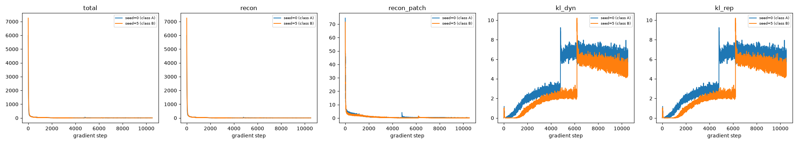
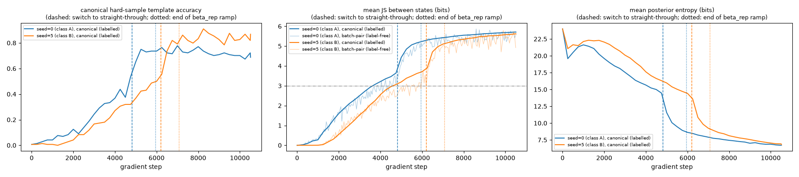
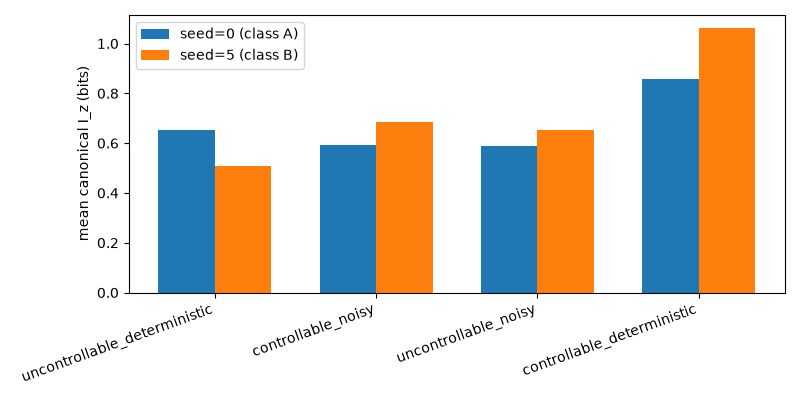
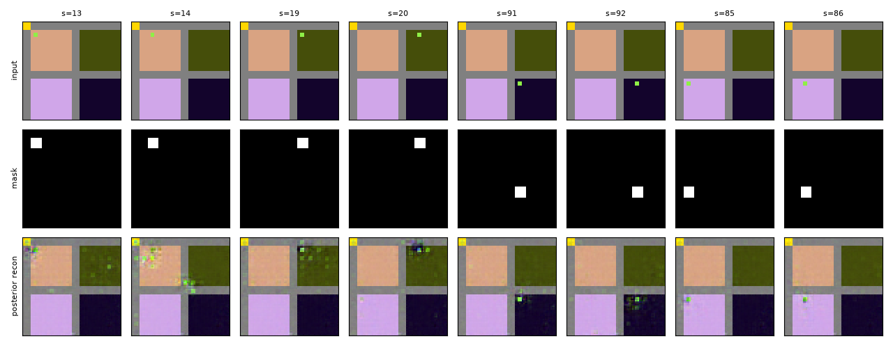
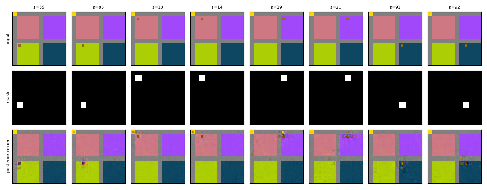

# E3 Phase 3 -- mini configuration report

Generated by `experiments/E3_worldmodel_4zones/run_mini.py` from `configs/e3/mini.yaml`, seeds [0, 5] (classes ['A', 'B']).

Verdict rules: MC-based checks use a 3-standard-error margin; an ordering whose gap is within 3 combined standard errors is "non concluant", never OK. If template-match accuracy is below 0.5, every indicator built on decoded images or on the posterior's discrimination (s-space kernel, L1, T4 preview, ghosts, D1, D2) is reported as "non évaluable (mécanique en échec)" instead of a value.

## Loss curves (per term)

Reconstruction is summed over channels and pixels of each image and averaged over batch x time; KL terms are exact, summed over latent variables, in nats. `recon_patch` is diagnostic only (unweighted error on the masked patch, same aggregation), not part of the loss.

## Separation between states along training

Canonical path (fresh h0, posterior of render(s)) for the 144 states, every `measure.separation_every` steps: if the switch to straight-through happens before the states have separated (JS ~ 0), the categorical bottleneck is expected to collapse again (docs/e3/ESTIMATOR_COMPARISON.md).

## Canonical I_z by zone type

## Seed 0 (class A)

### Loss terms (mean of the first / last 50 gradient steps)

Weights: recon x1 (patch weight w_patch=10 inside the mask); kl_dyn x0.5 from step 0; kl_rep 0 until the switch, then ramped linearly to x0.1 over 1142 steps; recon_patch x0 (diagnostic). 10512 gradient steps.

Posterior estimator: probabilities until the label-free batch-pair JS exceeded 3.0 bits on 5 consecutive evaluations (every 50 steps, from step 500, deadline 6307), then straight-through. **Effective switch step: 4801.** Learning rate 0.001 until the switch, then 0.0001 (changed at step 4801); global gradient-norm clipping: none; collapse guard after the switch: batch-pair JS < 1.0 bits on 5 consecutive evaluations.

Reproducibility: torch 2.14.0+cpu, 6 threads, commit `724bf64a6c63f96a8144e69a6d704226e30ee099` -- bit-exact only on the same machine with the same number of threads.

| term | start | end |
|---|---|---|
| total | 2060.6548 | 6.6234 |
| recon | 2060.3724 | 3.1386 |
| recon_patch | 26.2230 | 0.1903 |
| kl_dyn | 0.5648 | 5.8080 |
| kl_rep | 0.5648 | 5.8080 |

### Collapse diagnostics

- I(z; s) over the canonical posteriors (uniform over 144 states): **6.8705 bits** (MC se 0.0962; ceiling log2(144) = 7.1699; ~0 = collapse)
- Mean posterior entropy, canonical probe: **6.7069 bits**; replay (all 5248 posteriors): **6.4966 bits** (ceiling n_vars x log2(n_classes) = 24.0)

### I_z canonical (mean +/- std over states, per zone; MC se of the zone mean)

| zone | mean I_z | std I_z | MC se of the mean |
|---|---|---|---|
| uncontrollable_deterministic | 0.6526 | 0.2440 | 0.0163 |
| controllable_noisy | 0.5940 | 0.2326 | 0.0148 |
| uncontrollable_noisy | 0.5873 | 0.2250 | 0.0142 |
| controllable_deterministic | 0.8566 | 0.3755 | 0.0150 |

### KL(posterior || prior) by zone (canonical probe, mean over actions, bits)

| zone | mean KL (bits) |
|---|---|
| corridor | 12.1700 |
| uncontrollable_deterministic | 8.9603 |
| controllable_noisy | 13.4846 |
| controllable_deterministic | 12.7156 |
| uncontrollable_noisy | 18.5850 |

### Template-match accuracy / z-only probe

- Template-match accuracy on posterior reconstructions: **0.9902**
- z-only linear probe (every replay posterior): train accuracy **1.0000**, test accuracy **0.9876** (n_train=4199, n_test=1049)

### L1 of the s-space kernel vs P (true) and vs the tabular twin B, per zone

| zone | L1 vs P | L1 vs B |
|---|---|---|
| uncontrollable_deterministic | 1.7080 | 1.6681 |
| controllable_noisy | 1.8862 | 1.8549 |
| uncontrollable_noisy | 1.7875 | 1.7782 |
| controllable_deterministic | 1.8509 | 1.7978 |

### p_hat(frequent outcome) preview (T4 preview) -- noisy zones

| zone | mean p_hat(frequent outcome) |
|---|---|
| controllable_noisy | 0.3281 |
| uncontrollable_noisy | 0.3481 |

### Ghost rate (mean over all (s, a) pairs)

**0.0016**

### Context dispersion (mean abs discrepancy vs canonical I_z): **0.1981**

### D1 (alpha_app, local and global)

- Defined for 40/48 (own, target, local/global) probes.
- alpha_app over defined probes: mean=-1.2876, min=-8.1755, max=4.0664

| own zone | target zone | local/global | alpha_app |
|---|---|---|---|
| uncontrollable_deterministic | controllable_noisy | local | -5.5590 |
| uncontrollable_deterministic | controllable_noisy | global | 4.0050 |
| uncontrollable_deterministic | controllable_noisy | local | -8.1755 |
| uncontrollable_deterministic | controllable_noisy | global | 3.3528 |
| uncontrollable_deterministic | uncontrollable_noisy | local | -2.2661 |
| uncontrollable_deterministic | uncontrollable_noisy | global | 3.4947 |
| uncontrollable_deterministic | uncontrollable_noisy | local | -7.3924 |
| uncontrollable_deterministic | uncontrollable_noisy | global | 4.0664 |
| uncontrollable_deterministic | controllable_deterministic | local | -1.3008 |
| uncontrollable_deterministic | controllable_deterministic | global | -0.8123 |
| uncontrollable_deterministic | controllable_deterministic | local | -0.2928 |
| uncontrollable_deterministic | controllable_deterministic | global | -1.5913 |
| controllable_noisy | uncontrollable_deterministic | local | -1.2195 |
| controllable_noisy | uncontrollable_deterministic | global | -2.8116 |
| controllable_noisy | uncontrollable_deterministic | local | -3.5978 |
| controllable_noisy | uncontrollable_deterministic | global | -6.4371 |
| controllable_noisy | uncontrollable_noisy | local | undefined (no contrast) |
| controllable_noisy | uncontrollable_noisy | global | undefined (no contrast) |
| controllable_noisy | uncontrollable_noisy | local | undefined (no contrast) |
| controllable_noisy | uncontrollable_noisy | global | undefined (no contrast) |
| controllable_noisy | controllable_deterministic | local | -0.7063 |
| controllable_noisy | controllable_deterministic | global | -0.7962 |
| controllable_noisy | controllable_deterministic | local | -0.1432 |
| controllable_noisy | controllable_deterministic | global | 0.4262 |
| uncontrollable_noisy | uncontrollable_deterministic | local | -3.2444 |
| uncontrollable_noisy | uncontrollable_deterministic | global | 0.1037 |
| uncontrollable_noisy | uncontrollable_deterministic | local | -0.0083 |
| uncontrollable_noisy | uncontrollable_deterministic | global | -2.1980 |
| uncontrollable_noisy | controllable_noisy | local | undefined (no contrast) |
| uncontrollable_noisy | controllable_noisy | global | undefined (no contrast) |
| uncontrollable_noisy | controllable_noisy | local | undefined (no contrast) |
| uncontrollable_noisy | controllable_noisy | global | undefined (no contrast) |
| uncontrollable_noisy | controllable_deterministic | local | -0.1233 |
| uncontrollable_noisy | controllable_deterministic | global | -0.9633 |
| uncontrollable_noisy | controllable_deterministic | local | -0.1294 |
| uncontrollable_noisy | controllable_deterministic | global | 0.6167 |
| controllable_deterministic | uncontrollable_deterministic | local | -2.9525 |
| controllable_deterministic | uncontrollable_deterministic | global | -3.5316 |
| controllable_deterministic | uncontrollable_deterministic | local | -2.7568 |
| controllable_deterministic | uncontrollable_deterministic | global | -2.1338 |
| controllable_deterministic | controllable_noisy | local | -2.8117 |
| controllable_deterministic | controllable_noisy | global | 0.8556 |
| controllable_deterministic | controllable_noisy | local | -2.1859 |
| controllable_deterministic | controllable_noisy | global | 0.9163 |
| controllable_deterministic | uncontrollable_noisy | local | -3.0902 |
| controllable_deterministic | uncontrollable_noisy | global | 1.4096 |
| controllable_deterministic | uncontrollable_noisy | local | -2.0518 |
| controllable_deterministic | uncontrollable_noisy | global | 0.5311 |

### D2 -- neighbour JS distance, boundary vs within-zone

- boundary (different category) mean JS: **4.3392**
- within-zone (same category) mean JS: **3.6677**

## Seed 5 (class B)

### Loss terms (mean of the first / last 50 gradient steps)

Weights: recon x1 (patch weight w_patch=10 inside the mask); kl_dyn x0.5 from step 0; kl_rep 0 until the switch, then ramped linearly to x0.1 over 862 steps; recon_patch x0 (diagnostic). 10512 gradient steps.

Posterior estimator: probabilities until the label-free batch-pair JS exceeded 3.0 bits on 5 consecutive evaluations (every 50 steps, from step 500, deadline 6307), then straight-through. **Effective switch step: 6201.** Learning rate 0.001 until the switch, then 0.0001 (changed at step 6201); global gradient-norm clipping: none; collapse guard after the switch: batch-pair JS < 1.0 bits on 5 consecutive evaluations.

Reproducibility: torch 2.14.0+cpu, 6 threads, commit `724bf64a6c63f96a8144e69a6d704226e30ee099` -- bit-exact only on the same machine with the same number of threads.

| term | start | end |
|---|---|---|
| total | 2648.9817 | 5.3231 |
| recon | 2648.6412 | 2.3003 |
| recon_patch | 25.6878 | 0.1414 |
| kl_dyn | 0.6810 | 5.0380 |
| kl_rep | 0.6810 | 5.0380 |

### Collapse diagnostics

- I(z; s) over the canonical posteriors (uniform over 144 states): **6.8459 bits** (MC se 0.0823; ceiling log2(144) = 7.1699; ~0 = collapse)
- Mean posterior entropy, canonical probe: **6.8259 bits**; replay (all 5248 posteriors): **7.4869 bits** (ceiling n_vars x log2(n_classes) = 24.0)

### I_z canonical (mean +/- std over states, per zone; MC se of the zone mean)

| zone | mean I_z | std I_z | MC se of the mean |
|---|---|---|---|
| uncontrollable_deterministic | 0.5073 | 0.1502 | 0.0162 |
| controllable_noisy | 0.6862 | 0.2810 | 0.0153 |
| uncontrollable_noisy | 0.6524 | 0.3375 | 0.0155 |
| controllable_deterministic | 1.0615 | 0.4841 | 0.0163 |

### KL(posterior || prior) by zone (canonical probe, mean over actions, bits)

| zone | mean KL (bits) |
|---|---|
| corridor | 10.9824 |
| controllable_noisy | 11.0242 |
| uncontrollable_noisy | 16.9523 |
| uncontrollable_deterministic | 11.2456 |
| controllable_deterministic | 11.0502 |

### Template-match accuracy / z-only probe

- Template-match accuracy on posterior reconstructions: **0.9863**
- z-only linear probe (every replay posterior): train accuracy **0.9995**, test accuracy **0.9771** (n_train=4199, n_test=1049)

### L1 of the s-space kernel vs P (true) and vs the tabular twin B, per zone

| zone | L1 vs P | L1 vs B |
|---|---|---|
| uncontrollable_deterministic | 1.5567 | 1.5142 |
| controllable_noisy | 1.7560 | 1.7032 |
| uncontrollable_noisy | 1.7247 | 1.7061 |
| controllable_deterministic | 1.6923 | 1.5971 |

### p_hat(frequent outcome) preview (T4 preview) -- noisy zones

| zone | mean p_hat(frequent outcome) |
|---|---|
| controllable_noisy | 0.2554 |
| uncontrollable_noisy | 0.3280 |

### Ghost rate (mean over all (s, a) pairs)

**0.0025**

### Context dispersion (mean abs discrepancy vs canonical I_z): **0.1804**

### D1 (alpha_app, local and global)

- Defined for 40/48 (own, target, local/global) probes.
- alpha_app over defined probes: mean=0.6267, min=-3.4111, max=2.8213

| own zone | target zone | local/global | alpha_app |
|---|---|---|---|
| uncontrollable_deterministic | controllable_noisy | local | -0.2718 |
| uncontrollable_deterministic | controllable_noisy | global | 1.5235 |
| uncontrollable_deterministic | controllable_noisy | local | 2.8213 |
| uncontrollable_deterministic | controllable_noisy | global | 1.4287 |
| uncontrollable_deterministic | uncontrollable_noisy | local | 1.0533 |
| uncontrollable_deterministic | uncontrollable_noisy | global | 1.7443 |
| uncontrollable_deterministic | uncontrollable_noisy | local | 1.4478 |
| uncontrollable_deterministic | uncontrollable_noisy | global | 2.0858 |
| uncontrollable_deterministic | controllable_deterministic | local | 0.4761 |
| uncontrollable_deterministic | controllable_deterministic | global | 2.5657 |
| uncontrollable_deterministic | controllable_deterministic | local | 0.7499 |
| uncontrollable_deterministic | controllable_deterministic | global | 2.5941 |
| controllable_noisy | uncontrollable_deterministic | local | -3.4111 |
| controllable_noisy | uncontrollable_deterministic | global | -1.6977 |
| controllable_noisy | uncontrollable_deterministic | local | 0.3492 |
| controllable_noisy | uncontrollable_deterministic | global | 0.4852 |
| controllable_noisy | uncontrollable_noisy | local | undefined (no contrast) |
| controllable_noisy | uncontrollable_noisy | global | undefined (no contrast) |
| controllable_noisy | uncontrollable_noisy | local | undefined (no contrast) |
| controllable_noisy | uncontrollable_noisy | global | undefined (no contrast) |
| controllable_noisy | controllable_deterministic | local | 1.6404 |
| controllable_noisy | controllable_deterministic | global | 0.4817 |
| controllable_noisy | controllable_deterministic | local | 0.9349 |
| controllable_noisy | controllable_deterministic | global | 0.4712 |
| uncontrollable_noisy | uncontrollable_deterministic | local | 1.6502 |
| uncontrollable_noisy | uncontrollable_deterministic | global | 0.4461 |
| uncontrollable_noisy | uncontrollable_deterministic | local | 0.4557 |
| uncontrollable_noisy | uncontrollable_deterministic | global | -0.4324 |
| uncontrollable_noisy | controllable_noisy | local | undefined (no contrast) |
| uncontrollable_noisy | controllable_noisy | global | undefined (no contrast) |
| uncontrollable_noisy | controllable_noisy | local | undefined (no contrast) |
| uncontrollable_noisy | controllable_noisy | global | undefined (no contrast) |
| uncontrollable_noisy | controllable_deterministic | local | 2.0664 |
| uncontrollable_noisy | controllable_deterministic | global | 1.5506 |
| uncontrollable_noisy | controllable_deterministic | local | -0.1641 |
| uncontrollable_noisy | controllable_deterministic | global | 0.2875 |
| controllable_deterministic | uncontrollable_deterministic | local | 1.2534 |
| controllable_deterministic | uncontrollable_deterministic | global | -0.6823 |
| controllable_deterministic | uncontrollable_deterministic | local | -0.0440 |
| controllable_deterministic | uncontrollable_deterministic | global | -1.1296 |
| controllable_deterministic | controllable_noisy | local | 0.5570 |
| controllable_deterministic | controllable_noisy | global | 1.4074 |
| controllable_deterministic | controllable_noisy | local | -0.2301 |
| controllable_deterministic | controllable_noisy | global | -0.2403 |
| controllable_deterministic | uncontrollable_noisy | local | 1.5528 |
| controllable_deterministic | uncontrollable_noisy | global | 0.8105 |
| controllable_deterministic | uncontrollable_noisy | local | -0.4645 |
| controllable_deterministic | uncontrollable_noisy | global | -1.0568 |

### D2 -- neighbour JS distance, boundary vs within-zone

- boundary (different category) mean JS: **4.0444**
- within-zone (same category) mean JS: **3.2607**

## Expected-shape checklist (spec: "formes attendues seulement")

| # | check | seed (class) | expected | observed | verdict |
|---|---|---|---|---|---|
| 1 | I_z(conveyor) < I_z(controllable-det) | 0 (A) | gap > 3 x combined se | 0.6526 vs 0.8566 (gap 0.2040, combined se 0.0221) | OK |
| 2 | 0 <= I_z <= log2(5), per state within 3 MC se | 0 (A) | 0 violations | 0 violation(s) / 144 | OK |
| 3 | template-match accuracy high | 0 (A) | >= 0.5 (mini; calibration's C-a is 0.99) | 0.9902 | OK |
| 4 | alpha_app defined only with contrast | 0 (A) | per contrast_threshold | 40/48 defined | OK |
| 5 | I_z(conveyor) < I_z(controllable-det) | 5 (B) | gap > 3 x combined se | 0.5073 vs 1.0615 (gap 0.5542, combined se 0.0230) | OK |
| 6 | 0 <= I_z <= log2(5), per state within 3 MC se | 5 (B) | 0 violations | 0 violation(s) / 144 | OK |
| 7 | template-match accuracy high | 5 (B) | >= 0.5 (mini; calibration's C-a is 0.99) | 0.9863 | OK |
| 8 | alpha_app defined only with contrast | 5 (B) | per contrast_threshold | 40/48 defined | OK |