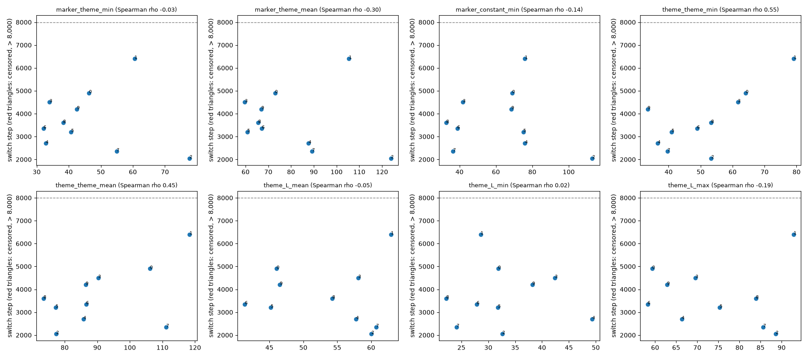

# E3 — theme sensitivity of the probabilities phase

How long the probabilities phase takes to separate the 144 states depends on the colour draw. Written for whoever analyses E3/E4/E5 runs: the switch step is a covariate (docs/e3/DECISIONS.md, 2026-09-25).

**Design (fixed before the runs, `experiments/E3_worldmodel_4zones/theme_sensitivity.py`).** Autoencoder isolation test, lr 0.001, batch 32, current procedure, k = 6, 10,000 steps, switch deadline 8,000. Only the colours vary (theme stream of seeds [0, 1, 2, 3, 4, 5, 6, 7, 8, 9]); layout, initialisation, minibatches and switch statistic are seed 0's. Final accuracy: hard sample, step 10,000. A draw that does not switch before 8,000 steps is **censored**: reported as "> 8,000", never dropped and never counted as 8,000.

## Switch step

- Draws: 10; switched before 8,000 steps: 10; **censored (> 8,000): 0**.
- Distribution over all 10 draws (censored draws ordered after every observed one): min 2051, lower quartile 2701, median 3351, upper quartile 4501, max 6401.

| draw | switch step | final hard-sample acc. | marker_theme_min | marker_theme_mean | theme_theme_min | theme_theme_mean | marker_constant_min | theme_L_mean | theme_L_min | theme_L_max |
|---|---|---|---|---|---|---|---|---|---|---|
| 0 | 4901 | 1.000 | 46.3 | 72.9 | 64.1 | 106.2 | 68.9 | 46.1 | 31.8 | 59.3 |
| 1 | 6401 | 0.929 | 60.5 | 105.4 | 79.1 | 118.3 | 75.9 | 62.9 | 28.6 | 92.9 |
| 2 | 2051 | 0.996 | 77.7 | 123.9 | 53.3 | 77.4 | 113.0 | 60.0 | 32.6 | 88.6 |
| 3 | 4501 | 0.988 | 34.0 | 59.7 | 61.6 | 90.3 | 41.8 | 58.1 | 42.4 | 69.6 |
| 4 | 2701 | 1.000 | 32.8 | 87.7 | 36.6 | 85.7 | 76.0 | 57.8 | 49.4 | 66.3 |
| 5 | 3201 | 1.000 | 40.7 | 60.7 | 40.9 | 77.2 | 75.0 | 45.2 | 31.8 | 75.3 |
| 6 | 3351 | 1.000 | 32.1 | 67.2 | 48.9 | 86.6 | 38.7 | 41.4 | 27.8 | 58.2 |
| 7 | 2351 | 1.000 | 54.9 | 89.2 | 39.6 | 111.2 | 36.5 | 60.7 | 24.1 | 85.6 |
| 8 | 3601 | 0.993 | 38.2 | 65.6 | 53.3 | 73.5 | 32.7 | 54.3 | 22.2 | 83.9 |
| 9 | 4201 | 0.979 | 42.6 | 66.9 | 33.4 | 86.5 | 68.5 | 46.5 | 38.2 | 62.8 |

## Spearman correlation of the switch step with the colour statistics

n = 10, of which 0 censored, ranked as the slowest draws (maximal rank, tied among themselves). Descriptive only: 10 draws, 8 statistics, no correction for multiple comparisons.

| group | statistic | rho | p |
|---|---|---|---|
| agent-theme contrast | marker_theme_min | -0.03 | 0.934 |
| agent-theme contrast | marker_theme_mean | -0.30 | 0.405 |
| agent-theme contrast | marker_constant_min | -0.14 | 0.701 |
| distances between themes | theme_theme_min | 0.55 | 0.098 |
| distances between themes | theme_theme_mean | 0.45 | 0.187 |
| theme lightness | theme_L_mean | -0.05 | 0.881 |
| theme lightness | theme_L_min | 0.02 | 0.960 |
| theme lightness | theme_L_max | -0.19 | 0.603 |

## Intrinsic variability: replicates at fixed colours

Same colours, layout and initialisation; different seeds for the latent draws and the minibatches. "original" is the draw's run above (historical streams).

| draw | original | replicate 1 | replicate 2 | replicate 3 | range | sd |
|---|---|---|---|---|---|---|
| 0 | 4901 | 6051 | 4601 | 4601 | 4601 - 6051 | 690 |
| 1 | 6401 | 4651 | 5051 | > 8,000 | 4651 - > 8,000 | undefined (censored) |

A censored run makes a standard deviation undefined, so the pre-declared ratio cannot be computed. Between colour draws: range 2051 - 6401; compare with the ranges above.

## RSSM / autoencoder factor and mini.yaml's switch deadline

Rule fixed before these results (docs/e3/DECISIONS.md, 2026-09-25).

| pair | RSSM switch step | autoencoder switch step | factor |
|---|---|---|---|
| seed 0, old themes (mini run / estimator comparison) | 4801 | 2301 | 2.09 |
| seed 0, new themes (mini_long / isolation test) | 4151 (grid12x12__4zones__pair-experimental__worldmodel-mini_long__seed00__20260925T223445Z) | 4901 | 0.85 |

**mini.yaml's deadline rule is closed without object**: mini.yaml is retired from current use and its budget is not increased (docs/e3/DECISIONS.md, 2026-09-28). What the rule would have given is kept below for the record.

Rule 1 (no censored draw): 6401 (max observed) x 2.09 (larger factor) x 1.25 = **16694** steps; cap 8,409.
Above the cap: the rule would have increased mini's budget (to at least 20,869 gradient steps); not applied (closed without object).

## Conclusion (criterion fixed in advance; recorded as decided by the user, 2026-09-28)

- The variability between replicates (same colours, other latent draws and minibatches) is of the same order as the variability between colour draws. The Spearman correlations with the colour statistics are therefore **not interpretable** with this design, and the switch step depends mostly on the randomness of training.
- The RSSM / autoencoder factor is **not stable**: 2.09 (seed 0, old themes: 4,801 / 2,301) and 0.85 (seed 0, new themes: mini_long 4,151 / 4,901).
- **1 run out of 16** (draw 1, replicate 3) did not separate before 8,000 steps: the start-up procedure is **not fully robust**.
- No further investigation for E3. The switch step stays a covariate of every analysis (DECISIONS.md, 2026-09-25), and every GPU run has a large absolute deadline; a run that does not separate is reported as a failure.
