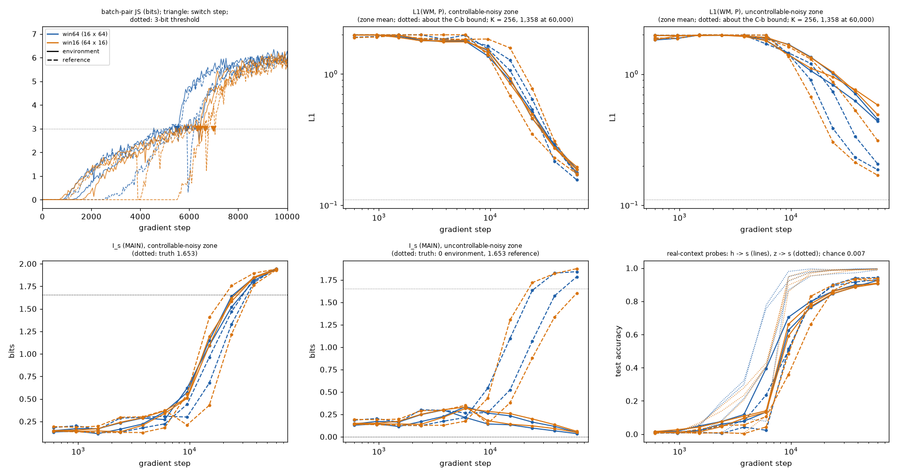
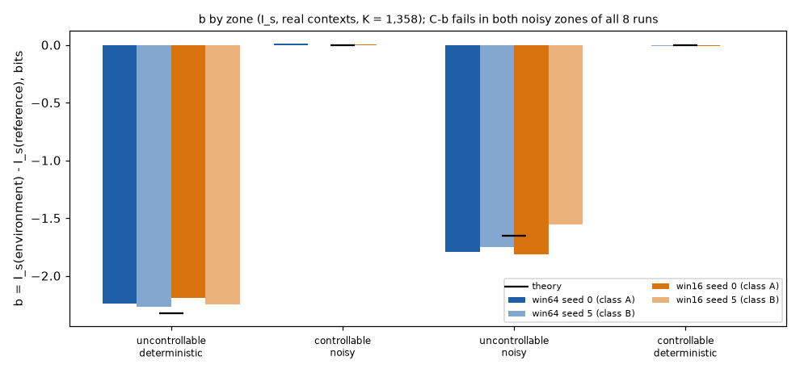

# E3 second GPU batch (gpu_e30b): analysis, 2026-09-30

Read-only analysis of the 8 runs pushed in `handoff/gpu_e30b/`: nothing was retrained or recomputed, the
measurement code is untouched. Everything below comes from each run's `results.json`, `arrays.npz`,
`diagnostics.jsonl`, `console.log` and `REPORT.md`, through `reports/gpu_e30b_analysis.py` (tables,
figures: `reports/gpu_e30b_figures.py`, `reports/figures/`) and `experiments/E3_worldmodel_4zones/aggregate_b.py`.
Zones are named by appearance: **ud** uncontrollable-deterministic, **cn** controllable-noisy, **un**
uncontrollable-noisy, **cd** controllable-deterministic; in the reference environment un and ud have the
dynamics of cn and cd. **2 seeds only** (seed 0 = block class A, seed 5 = class B): one run per (window shape,
seed, condition), so no run-to-run variance is available inside a class.

## 0. Preparation

- The 8 archives and `logs.tgz` were extracted into `results/E3_worldmodel_4zones/` and `logs/kubeflow/`
  (both ignored by git); `handoff/` was not touched.
- `source_sha256` in `meta.yaml` is `2c65bb74d1df6ea150cb186f61ff8977a92d4fa081c396641fa7b32d75d40728` in
  **8 / 8** runs (251 files): the code run is the code stated in RUN_GPU.md. `git_commit` is `unknown` in all 8
  (no git in the container: the content hash is the version record, as designed).
- Status: **8 / 8 `done`** in `meta.yaml`, `final_step` 60,000, `results.json` present; `handoff.md` says the same
  (exit code 0, done, results.json yes). Its "gradient steps done" column is `-` for every run only because a
  finished run's `meta.yaml` has no `steps_done`; nothing to worry about.
- One deviation to confirm with whoever ran the batch: RUN_GPU.md prescribes `--cpu 5`, but the preflight log
  states "3 usable CPU(s) (3 requested)". The preflight decided `launch` (projected 18.06 h, no warning, no
  problem, memory test passed); the batch took **14.6 h** wall (18:34 to 09:07 UTC), under the projection.
  GPU memory was not a constraint: peak reserved 2.2 to 2.5 GiB per process (8 processes on 80 GB).

## 1. Results

### Per run

### Table A -- switch, probes, durations

| run | switch (margin to 25,000) | h -> s / z -> s (full replay) | h -> s / z -> s (real contexts) | training h (of which 10 diagnostic points) | final measures min |
|---|---|---|---|---|---|
| win64 s0 exp | 6351 (18649) | 0.917 / 0.998 | 0.925 / 0.989 | 14.24 (0.82) | 14 |
| win64 s0 ref | 5901 (19099) | 0.906 / 0.995 | 0.943 / 0.996 | 14.33 (0.84) | 11 |
| win64 s5 exp | 5501 (19499) | 0.916 / 0.999 | 0.906 / 0.996 | 14.27 (0.80) | 13 |
| win64 s5 ref | 5501 (19499) | 0.908 / 0.998 | 0.930 / 0.996 | 14.32 (0.84) | 11 |
| win16 s0 exp | 6451 (18549) | 0.915 / 0.998 | 0.906 / 0.994 | 10.20 (0.81) | 28 |
| win16 s0 ref | 7001 (17999) | 0.906 / 0.993 | 0.938 / 0.987 | 10.25 (0.81) | 23 |
| win16 s5 exp | 6351 (18649) | 0.917 / 0.998 | 0.909 / 0.993 | 10.12 (0.81) | 28 |
| win16 s5 ref | 6651 (18349) | 0.905 / 0.997 | 0.923 / 0.997 | 10.27 (0.83) | 25 |

### Table B -- calibration (C-a, C-c >= 0.99; C-b: L1(WM, P) <= L1(B, P) + 0.05 over the pairs with N[s,a] >= 100; floor of the kernel's draws in brackets)

| run | C-a | C-c | C-b ud | C-b cn | C-b un | C-b cd |
|---|---|---|---|---|---|---|
| win64 s0 exp | 0.9961 ok | 0.9975 ok | 0.001 vs 0.061 (0.000) **ok** | 0.163 vs 0.104 (0.020) **FAIL** | 0.185 vs 0.107 (0.020) **FAIL** | 0.006 vs 0.059 (0.000) **ok** |
| win64 s0 ref | 1.0000 ok | 0.9952 ok | 0.033 vs 0.061 (0.000) **ok** | 0.156 vs 0.109 (0.020) **FAIL** | 0.186 vs 0.111 (0.020) **FAIL** | 0.019 vs 0.062 (0.000) **ok** |
| win64 s5 exp | 0.9980 ok | 0.9987 ok | 0.010 vs 0.061 (0.000) **ok** | 0.150 vs 0.103 (0.020) **FAIL** | 0.157 vs 0.110 (0.020) **FAIL** | 0.010 vs 0.059 (0.000) **ok** |
| win64 s5 ref | 0.9980 ok | 0.9981 ok | 0.016 vs 0.061 (0.000) **ok** | 0.170 vs 0.111 (0.020) **FAIL** | 0.208 vs 0.113 (0.020) **FAIL** | 0.018 vs 0.062 (0.000) **ok** |
| win16 s0 exp | 1.0000 ok | 0.9981 ok | 0.012 vs 0.061 (0.000) **ok** | 0.161 vs 0.104 (0.020) **FAIL** | 0.184 vs 0.107 (0.020) **FAIL** | 0.014 vs 0.059 (0.000) **ok** |
| win16 s0 ref | 0.9941 ok | 0.9928 ok | 0.051 vs 0.061 (0.000) **ok** | 0.173 vs 0.109 (0.020) **FAIL** | 0.170 vs 0.111 (0.020) **FAIL** | 0.014 vs 0.062 (0.000) **ok** |
| win16 s5 exp | 0.9980 ok | 0.9981 ok | 0.003 vs 0.061 (0.000) **ok** | 0.167 vs 0.103 (0.020) **FAIL** | 0.173 vs 0.110 (0.020) **FAIL** | 0.010 vs 0.059 (0.000) **ok** |
| win16 s5 ref | 1.0000 ok | 0.9973 ok | 0.023 vs 0.061 (0.000) **ok** | 0.172 vs 0.111 (0.020) **FAIL** | 0.313 vs 0.113 (0.020) **FAIL** | 0.025 vs 0.062 (0.000) **ok** |

### Table C -- I_s (MAIN) and I_z (secondary) by zone, real contexts, K = 1,358 (mean over the zone's states; se in brackets); theory from the run's own P

| run | I_s ud | I_s cn | I_s un | I_s cd | I_z ud | I_z cn | I_z un | I_z cd |
|---|---|---|---|---|---|---|---|---|
| win64 s0 exp | 0.020 [0.001] | 1.945 [0.003] | 0.050 [0.001] | 2.290 [0.001] | 0.176 [0.005] | 2.203 [0.003] | 0.333 [0.006] | 2.314 [0.001] |
| win64 s0 ref | 2.259 [0.001] | 1.937 [0.003] | 1.842 [0.003] | 2.293 [0.001] | 2.312 [0.002] | 2.188 [0.003] | 2.136 [0.003] | 2.316 [0.001] |
| win64 s5 exp | 0.029 [0.001] | 1.942 [0.003] | 0.035 [0.001] | 2.292 [0.001] | 0.325 [0.007] | 2.215 [0.003] | 0.298 [0.006] | 2.316 [0.001] |
| win64 s5 ref | 2.297 [0.001] | 1.945 [0.003] | 1.785 [0.003] | 2.301 [0.001] | 2.317 [0.001] | 2.222 [0.002] | 2.147 [0.003] | 2.322 [0.001] |
| win16 s0 exp | 0.041 [0.001] | 1.943 [0.003] | 0.060 [0.001] | 2.286 [0.001] | 0.261 [0.007] | 2.199 [0.003] | 0.376 [0.007] | 2.316 [0.001] |
| win16 s0 ref | 2.234 [0.002] | 1.940 [0.003] | 1.875 [0.003] | 2.299 [0.001] | 2.287 [0.002] | 2.188 [0.002] | 2.127 [0.003] | 2.318 [0.001] |
| win16 s5 exp | 0.043 [0.001] | 1.925 [0.003] | 0.048 [0.001] | 2.291 [0.001] | 0.289 [0.007] | 2.205 [0.003] | 0.428 [0.008] | 2.317 [0.001] |
| win16 s5 ref | 2.290 [0.001] | 1.930 [0.003] | 1.602 [0.003] | 2.292 [0.001] | 2.320 [0.001] | 2.224 [0.002] | 2.058 [0.003] | 2.321 [0.001] |
| theory, environment | 0.000 | 1.653 | -0.000 | 2.322 | (I_z has no closed form) | | | |
| theory, reference | 2.322 | 1.653 | 1.653 | 2.322 | | | | |

### Table D -- T4 (p_hat of the true frequent outcome, mean over the zone's (s, a), se over states) and I_s gap pooled - per context (4 states per zone, 10 contexts, 512 draws; se over states)

| run | T4 cn (true 0.90) | T4 un (true 0.90) | gap ud | gap cn | gap un | gap cd |
|---|---|---|---|---|---|---|
| win64 s0 exp | 0.897 [0.011] | 0.766 [0.042] | -0.010 [0.006] | -0.104 [0.017] | -0.050 [0.011] | -0.004 [0.004] |
| win64 s0 ref | 0.907 [0.006] | 0.877 [0.006] | -0.072 [0.025] | -0.128 [0.025] | -0.088 [0.041] | -0.027 [0.016] |
| win64 s5 exp | 0.901 [0.009] | 0.761 [0.036] | -0.025 [0.014] | -0.077 [0.013] | -0.048 [0.028] | -0.002 [0.001] |
| win64 s5 ref | 0.904 [0.007] | 0.861 [0.009] | -0.003 [0.003] | -0.039 [0.009] | -0.103 [0.018] | -0.003 [0.003] |
| win16 s0 exp | 0.898 [0.013] | 0.746 [0.045] | -0.015 [0.003] | -0.078 [0.012] | -0.043 [0.023] | -0.018 [0.018] |
| win16 s0 ref | 0.899 [0.006] | 0.889 [0.006] | -0.083 [0.043] | -0.069 [0.018] | -0.091 [0.015] | -0.001 [0.000] |
| win16 s5 exp | 0.891 [0.012] | 0.687 [0.051] | -0.021 [0.014] | -0.043 [0.014] | -0.085 [0.018] | -0.005 [0.003] |
| win16 s5 ref | 0.895 [0.006] | 0.796 [0.011] | -0.015 [0.006] | -0.080 [0.026] | -0.092 [0.026] | -0.014 [0.006] |

Notes on the tables. Î_s se = bootstrap se of the zone mean (within run); it does not contain seed-to-seed
variance. T4 is p̂ at the *true* frequent outcome of each (s, a), over all measured pairs of the zone (including
pairs seen fewer than 100 times). The gap is pooled − per-context: negative in all 32 cells, i.e. the pooled
I_s is below the average per-context I_s, as convexity requires; it is 0.04 to 0.13 bits in the noisy zones
(the bridge: 0.05 to 0.065), at most 0.03 in cd, and 0.00 to 0.08 in ud (largest for the reference's cd-dynamics
zone); 4 states per zone only.

Not in the tables (see `REPORT.md` of each run): D1/D2, ghost rate (0.001 to 0.004), context dispersion.
Timing: win64 trains 14.2 to 14.3 h (a diagnostic point ~5 min, K = 256), win16 10.1 to 10.3 h; the final
measures take 11 to 14 min for win64 and 23 to 28 min for win16 (real-context windows of 16 steps need about
twice as many unrolled windows).

### b = I_s(environment) − I_s(reference) by zone (`aggregate_b.py`; se = within-run, one seed per class)

| config / class | ud | cn | un | cd |
|---|---|---|---|---|
| win64 / A (seed 0) | −2.239 [0.002] | +0.008 [0.004] | −1.792 [0.003] | −0.003 [0.001] |
| win64 / B (seed 5) | −2.268 [0.001] | −0.004 [0.004] | −1.750 [0.003] | −0.009 [0.001] |
| win16 / A (seed 0) | −2.193 [0.002] | +0.002 [0.004] | −1.815 [0.003] | −0.013 [0.001] |
| win16 / B (seed 5) | −2.246 [0.001] | −0.005 [0.004] | −1.553 [0.003] | −0.001 [0.001] |
| theory | −2.322 | 0 | −1.653 | 0 |

Secondary, b on I_z: win64/A −2.136, +0.015, −1.803, −0.002; win64/B −1.992, −0.006, −1.849, −0.006; win16/A
−2.026, +0.011, −1.751, −0.001; win16/B −2.031, −0.019, −1.630, −0.005 (ud, cn, un, cd).

## 2. The three objectives (DECISIONS.md, 2026-09-30)

### (i) Does the window length explain the first batch's separation failures?

**Established by this batch**
- All 8 runs separate, in both shapes: switch at 5,501 to 6,351 steps (win64) and 6,351 to 7,001 (win16), margins
  before the 25,000 deadline of 17,999 to 19,499 steps. **The 64-step windows at 1,024 images per step, the
  shape of the two first-batch failures, do not prevent separation** when the network is the bridge's.
- win64 vs win16: mean switch 5,814 vs 6,614; win16 is later in 4 / 4 paired comparisons (same seed, same
  condition, same data: +100, +1,100, +850, +1,150 steps). With n = 4 per shape this is a tendency, not an
  established difference (sign test, two-sided p = 0.125). The JS trajectories have the same form in both:
  a rise from about 750 to 2,400 steps, a stall near 3 bits, then the 5-consecutive criterion. One run,
  win16 seed 0 reference, separates late and abruptly (JS about 0 until 5,450, above 3 bits at 6,650), like the
  first batch's successful seed 0 reference (5,250 to 6,250); win64 seed 0 reference does not.
- State information: z → s reaches 0.993 to 0.999 and h → s 0.905 to 0.918 (full replay), **identically in
  win64 and win16** (means 0.912 vs 0.911; on real contexts 0.926 vs 0.919). From 3,786 steps on, z → s is at
  or above h → s at every checkpoint of every run; at the first checkpoints (600 to 2,389) both are within
  0.05 of chance (0.007) and h is ahead of z by at most 0.010 in 16 of 88 checkpoints (differences of that size
  are noise). Before the switch h → s never exceeds 0.14. So no run shows state information carried by h ahead
  of z.
- What separates the first batch's failures from this batch's successes: the config diff between
  `gpu_e30.yaml` and `gpu_e30b_win64.yaml` is only the network (base_depth 32 to 8, embed_dim and h_dim 256 to 64),
  the deadline (40,000 to 25,000) and num_threads (4 to 1). Same procedure, same batch shape, same data per
  (seed, condition). Paired: seed 0 experimental failed, now separates (6,351); seed 5 reference failed, now
  separates (5,501); seed 0 reference succeeded and still does.

**Not established**
- That window length is irrelevant for the spec-size network: no spec-size run with 64 × 16 windows exists.
  The failures are associated with the spec-size network (2 paired cases), not with the window length, but
  network size is not the only thing that could differ (initial scale, effective learning rate for that size).
- That the failed runs' information passed through h: no h → s probe existed then. The only indication is the
  first batch's real-context template accuracy of 0.46 and 0.57 with a maximal-entropy posterior.
- The switch is later here than for the bridge (4,201, one run, 128 images per step): more images per step
  goes with a later switch, with one run on one side.

### (ii) Do 1,024 images per step make the noisy zones' kernel converge?

**No: C-b fails in both noisy zones of all 8 runs** (Table B): cn 0.150 to 0.173 against bounds of 0.103 to
0.111; un 0.157 to 0.313 against 0.107 to 0.113; the floor of the K = 1,358 draws is 0.020, so this is model
error. C-b holds in ud and cd in all 8 runs (0.001 to 0.051 against 0.061; 0.006 to 0.025 against 0.059 to 0.062;
win16 seed 0 reference is closest in ud, 0.051). C-a (0.994 to 1.000) and C-c (0.993 to 0.999) hold in all 8.

Against the bridge (8 × 16): cn C-b 0.265 → 0.150 to 0.173; T4 in cn 0.79 → 0.89 to 0.91; un (environment)
C-b 0.191 → 0.157 to 0.185, T4 0.63 → 0.69 to 0.77. Larger batches help cn clearly and un little.

T4 is met in cn in 8 / 8 (0.891 to 0.907 for a truth of 0.90). It is **not** met in un: 0.687 to 0.766 in the
environment (where un is uncontrollable-noisy and rarely visited: only 27 to 29 of 125 pairs have N ≥ 100, and
those pairs are over-confident, p̂ = 0.96 to 0.98), 0.796 to 0.889 in the reference (un has cn dynamics there).

**Convergence at the end of the runs.** Zone-mean L1(WM, P) between 37,858 and 60,000 steps still falls, cn from
0.27 to 0.31 (0.22 to 0.23 for the reference seed 0 runs) to 0.16 to 0.20, ratio 0.6 to 0.75, and by less than
in the previous 14,000 steps (a deceleration; the change of K from 256 to 1,358 accounts for about 0.004 of the
drop, in quadrature). T4 (mean max probability) in un keeps rising (0.63 → 0.77, 0.66 → 0.76, 0.61 → 0.75,
0.60 → 0.69 in the four environment runs). So the kernel is still converging, but decelerating, and part of
the error looks structural rather than a matter of time:
- in cn the frequent outcome is right (0.92 vs 0.90) but the residual mass is concentrated (sorted p̂ 0.919,
  0.034, 0.015, 0.009, 0.005 against 0.9, 0.025 × 4) and 4 to 5 % of the mass is on states outside the true
  5-outcome support; L1 ≈ 0.16 comes from that shape error, not from T4;
- I_s in cn is **1.93 to 1.95 against 1.653** (+0.27 to +0.29 in 8 / 8 runs), still rising at the last
  checkpoints (1.85 → 1.94 from 37,858 to 60,000). Decomposition: H(s'|s,a) is right (0.64 to 0.78 vs 0.67) and
  the excess is in the marginal H(s'|s) (2.58 to 2.70 vs 2.32): the off-support mass;
- in the noisy zones the uncertainty of the predicted code is spread over almost all latent variables (on the
  3 runs examined, win64 seed 0 environment, win64 and win16 seed 5 reference: 6.8 to 7.7 of 8 variables with
  max probability < 0.98, against 2.4 to 3.1 in the deterministic zones; probability of the joint mode 0.19 to
  0.31 against 0.65 to 0.73). A prior that is a product of 8 independent categoricals
  produces hybrid codes when the alternatives differ in many variables: **a hypothesis** for the off-support
  mass, consistent with these numbers, not tested (it would need decoding, or a run).

### (iii) The first floor of b

- **No pair meets all the calibration criteria** (C-b fails in the noisy zones for both members of all 4 pairs);
  C-a and C-c hold for all 8 runs, C-b holds in ud and cd for all 8.
- b in the zones where the criteria hold is close to the theory: ud −2.19 to −2.27 (theory −2.322, 94 to 98 %,
  the shortfall coming from I_s(environment, ud) = 0.02 to 0.04 rather than 0 and I_s(reference) = 2.23 to 2.30
  rather than 2.32); cd and cn ≈ 0 (−0.013 to +0.008), as they must (same dynamics on both sides).
- b in un is **not calibrated**: −1.55 to −1.82 against −1.653. Its spread between runs (0.26) is far larger
  than the within-run se (0.003): it is dominated by how well the reference's un zone (cn dynamics) has
  converged (I_s(reference, un) = 1.60 to 1.88, still rising; win16 seed 5 is the low end, C-b 0.313, T4 0.80).
- By configuration: win64 gives ud −2.24, −2.27 and un −1.79, −1.75 (A, B); win16 gives ud −2.19, −2.25 and un
  −1.82, −1.55. On I_s the two shapes are not distinguishable in ud, cn, cd; in un win16 is more dispersed.
- I_z as secondary: in ud, b on I_z is smaller in magnitude than on I_s (−1.99 to −2.14 against −2.19 to −2.27:
  it understates the reduction by 0.10 to 0.28); in un it is comparable (−1.63 to −1.85 against −1.55 to −1.82).

## 3. Consistency checks and what contradicts an expected form

- **I_s against theory.** ud (environment) 0.020 to 0.043 (0), un (environment) 0.035 to 0.060 (0), cd 2.286 to
  2.301 (2.322), reference ud with cd dynamics 2.234 to 2.297: I_s recovers the truth there, to within 0.03 to
  0.09. **cn does not: +0.27 to +0.29 in all 8 runs** (the bridge was at +0.05, with a less converged kernel).
  So "I_s recovers the truth where it is known" holds for ud, un (environment) and cd, and fails for cn.
  Since cn has the same dynamics on both sides, the overestimate cancels in b for cn (b ≈ 0) but not for the
  reference's un zone (cn dynamics, 1.60 to 1.88).
- **I_z against I_s: the bridge's bias is found again.** I_z − I_s in the environment's uncontrollable zones is
  +0.16 to +0.30 (ud) and +0.26 to +0.38 (un), where the truth is 0; +0.25 to +0.29 in cn; +0.02 to +0.03 in cd
  (the bridge: 0.22, 0.22, 0.36, 0.13). I_z is 0.18 to 0.43 in the uncontrollable zones.
- **Reference seed 0, win64, against the first batch's reference seed 0 (spec-size network), at the same
  K = 32** (the win64 kernel was resampled to 32 draws to be like for like; an approximation, one run each):
  L1(WM, P) on N ≥ 100 pairs: 0.004 / 0.167 / 0.182 / 0.002 (spec) against 0.032 / 0.195 / 0.224 / 0.020 (win64);
  I_s 2.315 / 1.970 / 1.895 / 2.319 against 2.276 / 2.017 / 1.915 / 2.300; T4 0.923 / 0.901 against 0.907 / 0.877;
  C-a 0.990 vs 1.000; C-c 0.959 vs 0.995; switch 7,051 vs 5,901. Same order of magnitude everywhere; the
  spec-size network is more precise in the deterministic zones (L1 0.002 to 0.004 vs 0.02 to 0.03), the small
  one has the better z-only probe and separates earlier.
- **Contradictions of expected forms.** (1) C-b fails in the noisy zones (8 / 8). (2) T4 is not near 0.9 in
  un in the environment (0.69 to 0.77), against the T4 form "→ 0.9 in both noisy zones". (3) The "KL of a
  deterministic zone ends below 1 bit" form fails narrowly in the environment's ud zone for 3 of 4 runs (final
  1.057, 1.060, 1.099 bits; win64 seed 0: 0.688); every other real-context shape check conforms, in all 8
  runs (KL, L1 decreasing, I_s decreasing in ud / increasing in cd; the canonical-probe versions are not
  conforming, by construction, see the report). (4) The I_z ≤ log2 5 check has one violation in win16 seed 5
  reference (state 105, cd, I_z 2.340, 3.03 se above the bound): marginal, secondary measure. I_s has none.
  (5) I_s in cn above the truth, above.

## 4. Decisions to take (nothing is chosen here)

**A. Which window shape to carry forward?** The measures do not separate them beyond seed-to-seed spread.
- *win64 (16 × 64)*: earlier switch in 4 / 4 pairs (mean 5.8k vs 6.6k, all within 5.5k to 6.4k); the shape of
  the spec and of the first batch (comparability); real contexts with 56 eligible steps per window; training
  +40 % (14.3 h vs 10.2 h), final measures half as long (11 to 14 min vs 23 to 28 min).
- *win16 (64 × 16)*: 30 % cheaper to train; same C-a, C-c, C-b and T4 within noise; but the latest switch
  (7,001), the one late and abrupt separation, and the worst reference un zone (seed 5: I_s 1.60, L1 0.313,
  T4 0.80). Real contexts are 16-step windows (8 of burn-in), a shorter-history regime.
- *Both*: keeps the comparison open at twice the cost. Reserves for any choice: 2 seeds, one run per cell,
  n = 4 per shape.

**B. The noisy zones' C-b.** None of the configurations meets it. Options:
1. Keep the criterion and train longer (the L1 falls, decelerating, T4 in un rises); the extrapolation is
   unreliable, and the structural components (off-support mass, over-concentrated residual, I_s in cn) did not
   fall over the last checkpoints (I_s in cn rose).
2. Keep the criterion, accept its failure and carry the documented reserve: kernel over-confident in noisy zones,
   I_s in cn +0.29 (cancels in b for cn), b in un uncertain by about ±0.15 from the reference's un zone.
3. Revise the criterion for the noisy zones (for example T4 in cn plus a bound on I_s, instead of the L1 to
   the counts' kernel): a change made after seeing the results, to be recorded as such (as the K_s correction was).
4. Investigate the structural cause first (the factorised-prior hypothesis: a decoding experiment on the saved
   weights, which are on the cluster but not in the handoff), before choosing 1 to 3.

**C. Is I_s still the right main measure?** It recovers the truth in ud, un (environment) and cd, and cancels
in b for cn, but overestimates cn by 0.29 (I_z by 0.55 there). Options: keep it with the documented bias;
keep it and add the off-support mass as a reported diagnostic; or report b by zone class rather than an
average over zones.

**D. What b to report as the first floor.** The reliable ones are ud (−2.19 to −2.27) and the null controls
(cn, cd); un needs A/B first. More seeds per class (the current classes each hold one seed) are needed before
any class comparison.

**E. Cost of the next batch.** GPU memory is not limiting (2.5 GiB per process); the batch is CPU-bound
(3 CPUs, 8 processes, about 1.17 steps/s for win64). The preflight projection (18.1 h) overestimated the wall
time (14.6 h). If the batch is repeated, `--cpu 5` (as prescribed) may shorten it; the preflight said 3.
