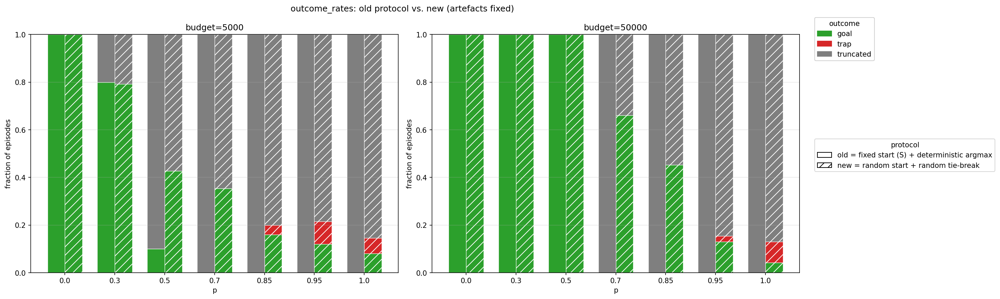
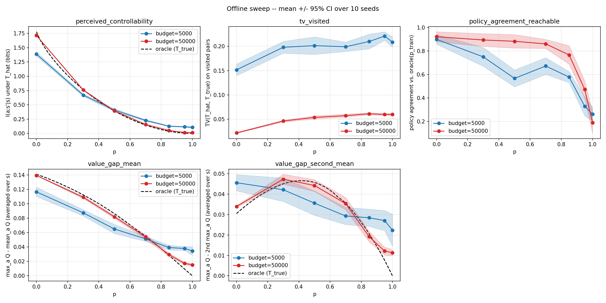
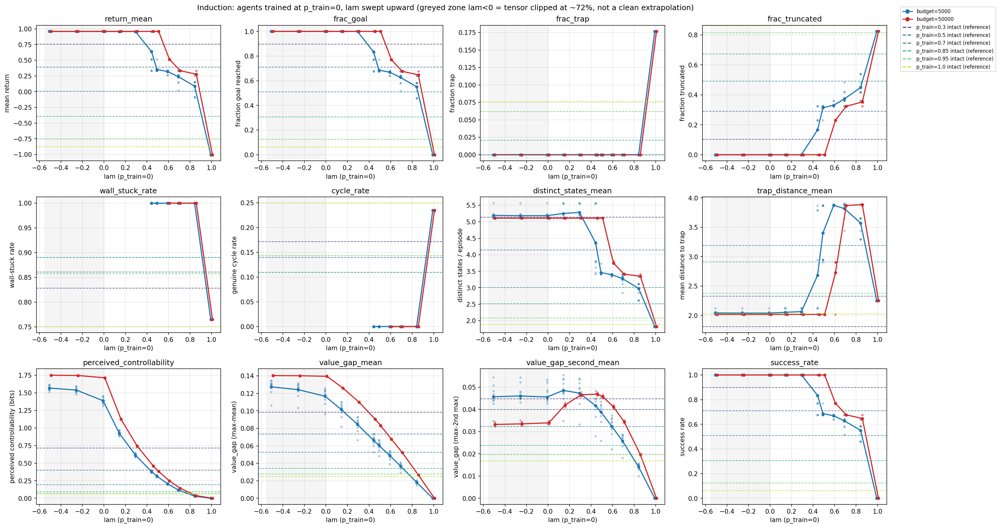
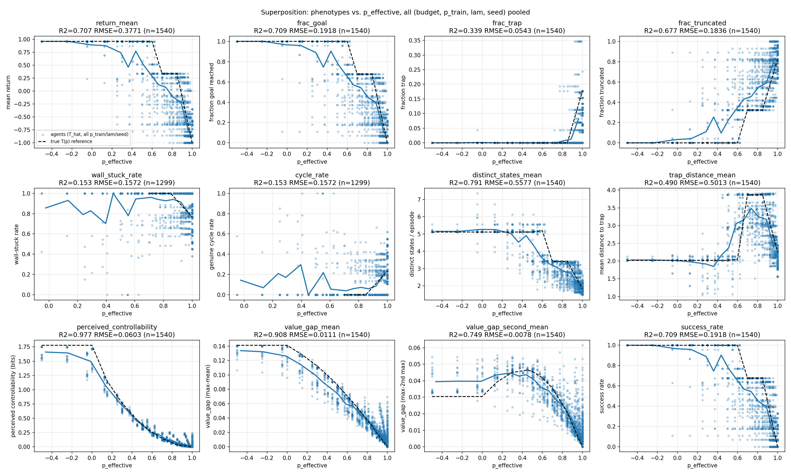
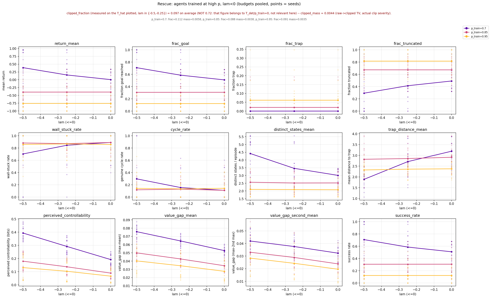
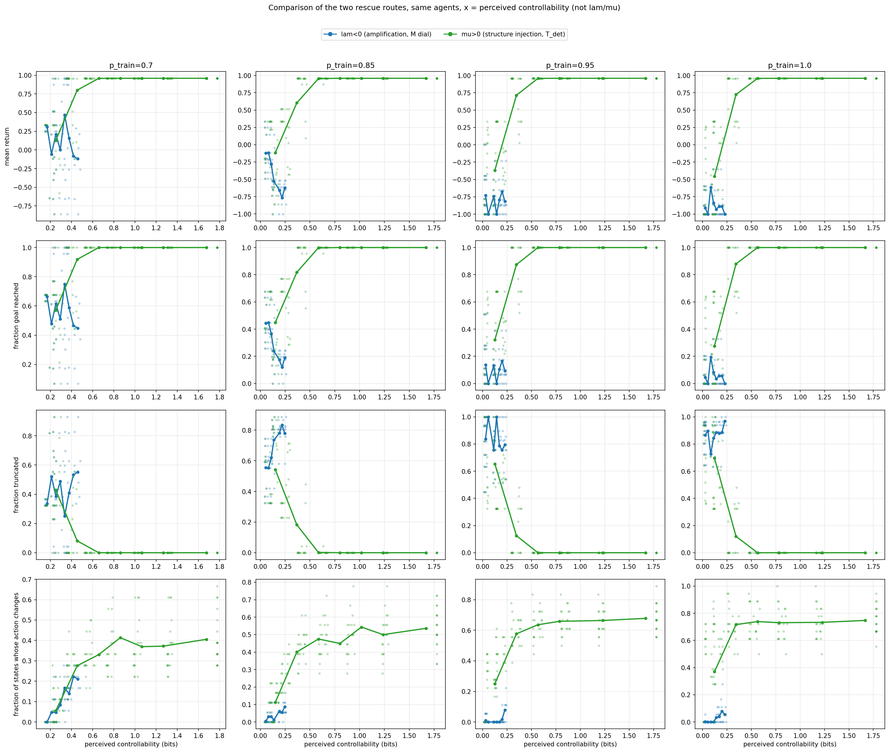

# Perceived controllability as a causal determinant of behaviour: an offline model-based study

**Week 1 report — 01/09 to 04/09**

---

## 1. Question

Two questions, one methodological and one substantive:

1. Does an agent's **perceived controllability** of its training environment causally determine its behaviour when evaluated in a fully controllable ("healthy") environment?
2. Can that quantity be **directly manipulated** in the agent's internal representation of the world, and does the manipulation reproduce the behavioural phenotype?

The second question is the one that matters for the wider project. The long-term aim is to train a world model, extract quantifiable behavioural phenotypes from its trajectories in a healthy environment, and then intervene on its latent state to identify what produced those alterations. This week is a rehearsal of that pipeline in the simplest possible setting — one where the "latent" is a transparent, directly readable object, so that every step of the intervention protocol can be verified against ground truth before it is applied blind to a neural model.

I therefore deliberately chose a minimal environment, a minimal agent, and the most interpretable possible world representation.

---

## 2. Setup

### Environment

A 5×5 gridworld: one start, one terminal goal (+1), two terminal traps (−1), four walls, step cost −0.01, episode cap 100 steps, γ = 0.95. Eighteen non-terminal states, so 72 reachable state–action pairs.

The single manipulated parameter is **p**: at each step, with probability p the chosen action is replaced by a uniform draw over the four directions. The probability of executing the intended action is therefore (1−p) + p/4, and controllability falls linearly to exactly zero at p = 1.

The layout has a deliberate property: two paths of length 8 reach the goal, one of them running alongside a trap. The detour costs nothing in distance, which isolates risk aversion from movement cost.

### Agent

Tabular model-based. Transition counts `N[s,a,s']` give `T̂` by frequency (Dirichlet prior α = 0.1); rewards give `R̂` by averaging; the policy is obtained by value iteration on `(T̂, R̂)`. The planner is identical across every agent, so any behavioural difference is attributable to the beliefs and not to the planning budget.

This choice is central to the study. A model-free agent's belief about controllability and its belief about value are fused in a single scalar `Q(s,a)`. A model-based agent keeps `T̂` and `R̂` structurally separate, which makes perceived controllability measurable independently of perceived value — and, as it turns out, directly editable.

### Training protocol: offline, with an automatic yoked control

Data collection uses a **fixed uniform random policy**, identical in every condition, with an identical transition budget (5k and 50k, counted in transitions rather than episodes).

This has a property worth stating explicitly, because it is the methodological foundation of everything that follows. Under a uniform collection policy the *effective* action distribution is uniform regardless of p. Verified empirically: mean episode length and state visitation distributions are identical to three decimal places from p = 0 to p = 0.95.

**The training trajectories are statistically identical across all values of p.** What changes is only the labelling: the agent records (s, a_intended, r, s′), and p destroys the contingency between the intended action and the outcome, not the outcome distribution itself.

This is the exact analogue of Seligman's yoked control — same sensorimotor experience, same exposure to traps, same coverage, only the action–outcome contingency differs — obtained automatically rather than by design. The offline condition is therefore a clean causal isolation of the belief pathway, not a convenience.

### Evaluation

All agents are evaluated at p = 0 with learning disabled and the planner frozen. Start states are drawn uniformly over all non-terminal states from a fixed evaluation seed shared across every agent and condition; ties in the argmax are broken at random.

Both of these were corrections made mid-week. With a single fixed start and deterministic `np.argmax`, high-p agents pushed against the top-left border for 100 steps — an artefact of index ordering crossed with start position, not a behavioural result. The metrics also only probed a handful of states. The corrected protocol produces genuine cycles and recovers real trap entries at p ≥ 0.95.



> **Figure 1** — outcome rates by p, old protocol (fixed start + deterministic argmax) vs corrected protocol (random start + random tie-break), both budgets.

### Metrics

**Belief:** perceived controllability I(a;s′|s) in bits under `T̂`; TV distance between `T̂` and the true tensor on visited pairs; value gap `max_a Q − mean_a Q` and decision margin `max_a Q − second_max_a Q`.

**Behaviour:** outcome rates (goal / trap / truncated), return vs oracle, distinct states per episode, wall-stuck and cycle rates, mean trap distance, latency to goal with its censoring rate.

The controllability ceiling on this layout is **1.778 bits**, not 2, because walls and borders make several actions lead to the same cell. That is the normalisation reference.

---

## 3. Results

### 3.1 Agents learn their world correctly, and fail on transfer — gradually, not sharply

At 50k transitions, TV(`T̂`, `T_true`) on visited pairs stays between 0.02 (p = 0) and 0.06 (p = 1). Agents at every p have accurately estimated their own dynamics.

Under the corrected evaluation protocol (random start, random tie-break — see Evaluation above), outcome rates at p = 0 show a **graded collapse** of goal-directed behaviour rather than a step function:

| p_train | goal | trap | truncated | return_mean |
|---|---|---|---|---|
| 0.0 | 100% | 0% | 0% | 0.96 |
| 0.3 | 100% | 0% | 0% | 0.96 |
| 0.5 | 100% | 0% | 0% | 0.96 |
| 0.7 | 66.2% | 0% | 33.8% | 0.30 |
| 0.85 | 45.2% | 0% | 54.8% | −0.11 |
| 0.95 | 13.1% | 2.4% | 84.6% | −0.74 |
| 1.0 | 4.3% | 8.8% | 86.9% | −0.92 |

*(50k budget, pooled over the 10 seeds; the 5k budget starts dropping as early as p = 0.3 and reaches only 8% goal at p = 1 — it switches earlier and less cleanly.)*

Three things stand out.

**The failure is a graded loss of goal-directed behaviour, not a threshold switch.** Goal rate declines monotonically from p = 0.5 onward — 100% → 66% → 45% → 13% → 4% — rather than flipping between two regimes. Under the old fixed-start, deterministic-argmax evaluation this looked like a clean cliff between p = 0.5 and p = 0.7; that was an artefact of probing a single trajectory (see Evaluation), not a property of the underlying policies.

**Traps are entered, but only once avoidance itself starts to fail.** At p = 0.7–0.85 the trap rate is still exactly 0%: the agents that don't reach the goal are truncating, not dying. Real trap entries only appear at p ≥ 0.95 (2.4%, then 8.8% at p = 1) — `trap_min_distance_mean` over these episodes drops from 1.91 (p = 0.85) to 1.69 (p = 1), i.e. the safety margin the agent keeps around the trap itself erodes at the highest p. Avoidance is not perfect throughout; it degrades last, after goal-seeking has already collapsed.

**Truncated episodes are a mix of wall-stuck and genuine cycling, not a uniform −1.00.** `wall_stuck_rate` among truncated episodes is ~100% at p = 0.7 and stays above 80% through p = 1, but a `cycle_rate` of period-2 oscillation (the only way to "stay still" with 4 actions) appears from p = 0.85 onward and reaches 19% of truncated episodes at p = 1. The agent's incoherent policy was never penalised during training because at high p the environment's own noise kept breaking any would-be cycle; executed noise-free at p = 0, the same action arrangement becomes an absorbing loop or a wall-push. The policy depended on noise to function, and that dependence surfaces more explicitly as p increases.

This is still **maladaptive transfer of a veridical belief**, not a learning failure — but it is a graded phenotype with real risk at the extreme, not a binary "perfect success vs perfect safety" switch. The distinction matters and is returned to in §4.



> **Figure 2** — offline sweep: perceived controllability, TV(visited), value gap, value gap (second), and policy agreement vs oracle(p_train), one curve per budget with 95% CI over seeds. (Outcome rates by p are reported as a table above rather than plotted here.)

### 3.2 The phenotype is carried entirely by the transition belief

Component swaps between a low-p and a high-p agent, replanned with the same planner and evaluated at p = 0:

| condition | mean return |
|---|---|
| intact_low | +0.920 |
| intact_high | −1.000 |
| T_high + R_low | **−1.000** (follows T) |
| T_low + R_high | **+0.920** (follows T) |
| T_true + R_high | +0.920 |
| T_high + R_true | −1.000 |
| oracle | +0.920 |

Identical across all three high-p donors. `R̂` is intact and irrelevant; the deficit lives entirely in `T̂`. This was the prior expectation — reward is deterministic given s′, so `R̂` converges almost immediately at any p — but it is now verified from both sides of the swap rather than assumed.

### 3.3 Editing the belief reproduces the phenotype

The transition tensor decomposes exactly:

```
T(p)[s,a,:] = (1−p)·T_det[s,a,:] + p·M[s,:],    M[s,:] = mean_a T_det[s,a,:]
```

with **M invariant in p** — which is also the formal reason the collection trajectories are identical across conditions. The "direction of p" in tensor space is therefore known in closed form; no learned probe or regression is required.

This yields a controllability dial applicable to any agent's belief:

```
T_λ = M̂ + (1−λ)·(T̂ − M̂),    M̂ = mean_a T̂
```

λ = 0 leaves the belief intact, λ = 1 collapses it to zero controllability, λ < 0 sharpens it. For λ ∈ [0,1] this is a convex combination, so simplex constraints hold automatically. If `T̂ ≈ T(p_train)`, then `T_λ = T(p_eff)` with `p_eff = p_train + λ(1−p_train)`.

**Induction.** Applying the dial to healthy (p_train = 0) agents and re-planning, while the evaluation environment stays at p = 0 throughout, reproduces a decline of the same character, though smoother than the discrete switch seen in training: return falls steadily from λ ≈ 0.3 (+0.958) through λ = 0.85 (+0.183, goal rate down to 60%), and only turns catastrophic — return ≈ −1.0, trap entries appearing for the first time — at λ = 1. Only the belief changed.

The dial also reproduces secondary structure, which is a stronger validation than the main effect: the non-monotonic peak in decision margin near λ ≈ 0.3 appears in both the training sweep and the intervention. Moderate noise *creates* margin by breaking the degeneracy between the two equal-length paths — with 3/18 states exactly tied at p = 0 and 0/18 at p = 0.3 — before destroying it at higher values.


> **Figure 3** — induction: all phenotypes vs λ for p_train = 0, with intact high-p references overlaid.


### 3.4 Perceived controllability predicts severity, not topography

Plotting every (p_train, λ, seed) combination against `p_eff` tests whether the route to a given perceived controllability matters. Variance explained by `p_eff` alone (n = 1540):

| metric | R² | | metric | R² |
|---|---|---|---|---|
| value_gap_mean | 0.908 | | frac_trap | 0.339 |
| distinct_states | 0.791 | | wall_stuck / cycle rate | 0.153 |
| value_gap_second | 0.749 | | | |
| success_rate / frac_goal | 0.709 | | | |
| return_mean | 0.707 | | | |
| frac_truncated | 0.677 | | | |

*(perceived_controllability itself gives R² = 0.977 — this is a technical check that the dial is correctly implemented, not a result.)*

The pattern is systematic: everything **quantitative and global** collapses; everything **categorical and local** does not. Perceived controllability determines *how much* the agent fails, not *where* or *how*. The precise composition of failure depends on where the errors sit in that particular `T̂`, not on its overall controllability level.

Two caveats. `frac_trap` is near-zero over most of the domain, so a low R² there partly reflects a degenerate variable rather than a failed prediction — a logistic model restricted to p_eff > 0.8 would be the appropriate test. And wall_stuck and cycle rates are complementary by construction here, so their identical R² is algebraic, not independent evidence.

**The collapse is also imperfect in a systematic direction.** Induction consistently *underestimates* real severity:

| λ (= p_eff) | induced return | real return at p_train = λ |
|---|---|---|
| 0.7 | +0.286 | +0.004 |
| 0.85 | +0.183 | −0.394 |
| 1.0 | −1.004 | −0.879 |

The interpretation: an agent trained at high p acquires a belief that is both *blurred* and *noisy*. A near-deterministic target is easy to estimate from few samples; a near-uniform one requires far more, which is why TV grows with p at fixed budget. The dial blends cleanly toward M and cannot reproduce the additional estimation noise. Consistent with this, the 5k curves — which carry more estimation noise — sit systematically closer to the real references than the 50k curves.



> **Figure 4** — superposition: all phenotypes vs p_eff, all (budget, p_train, λ, seed) pooled, with the ground-truth reference curve.

### 3.5 Rescue: amplification fails where injection succeeds

Two routes back.

**Amplification (λ < 0).** Expanding the Q-values under the dial:

```
Q_λ(s,a) = A(s) + (1−λ)·c(s,a)
```

where `A(s)` is action-independent and `c(s,a)` is the action contrast. Since (1−λ) > 0, the *ordering* of actions is invariant at fixed V. The dial can only change behaviour through the second-order effect of the Bellman recursion.

Measured directly:

| p_train | return at λ=0 | return at λ=−0.5 | states whose action changes |
|---|---|---|---|
| 0.7 | +0.004 | **+0.387** | 2–5 / 25 |
| 0.85 | −0.394 | −0.396 | 0–3 / 25 |
| 0.95 | −0.7559 | −0.7559 | 0–4 / 25 |

At p_train = 0.95 the return is bit-identical across λ; the policy array itself is nearly frozen (a handful of states flip depending on seed and budget, none of which move the measured return). The dial amplifies whatever structure is already in `T̂` and cannot inject structure that was never learned. At p = 0.7 the deviations from M still encode genuine information, so amplifying them amplifies signal; at p = 0.95 the true deviation is only (1−p) = 0.05 and what remains is mostly estimation noise, which rescales uniformly and changes almost nothing.

At p_train = 0.85 amplification leaves the return essentially flat (−0.394 → −0.396) even as perceived controllability rises — confidence in the policy increases without the policy itself improving, a milder instance of the same "certain and wrong" mechanism seen more starkly at p_train = 0.95.



> **Figure 5** — rescue via amplification: all phenotypes vs λ ≤ 0 for agents trained at high p, points = seeds.

**Injection (μ > 0):** `T_μ = (1−μ)·T̂ + μ·T_det`, a convex combination requiring no clipping. This restores optimal behaviour at **every** p_train including 1.0, reaching the oracle return by roughly 0.6 bits of perceived controllability, with 40–75% of states changing action.

The dissociation is complete and gives the sharpest statement of the week: **the severe deficit is informational, not one of amplitude.** The belief has not merely been attenuated — it has lost its geometry. Rescaling an empty belief produces nothing; the structure has to be re-supplied.



> **Figure 6** — two rescue routes, same agents, x-axis = perceived controllability in bits, faceted by p_train, with the fraction of states whose action changes.

*Technical note: clipped fraction under λ < 0 is 0.08–0.12 on learned tensors (versus 0.72 on the deterministic ground truth, where entries are exactly zero); clipped mass — the actual severity of the renormalisation — is smaller still (mean ≈ 0.004). So the amplification route is a clean intervention in precisely the regime where it is applied.*

---

## 4. What this establishes, and what it does not

**Established.** Perceived controllability, however acquired, causally determines the *severity* of behavioural impairment in a healthy environment. The pathway runs entirely through the transition belief; reward beliefs are intact and irrelevant. The relationship is manipulable in both directions, and the asymmetry between the two rescue routes has a mechanistic explanation confirmed at the level of individual policy entries.

**Not established.** What is documented is **maladaptive transfer of a veridical belief**. The agent learned something true about its world and applied a policy that was optimal there. That is not yet learned helplessness in the sense of Maier & Seligman: their defining criterion is not *acting badly* but **failing to relearn that control has returned**. It is that relearning deficit which separates a benign biased prior — corrected within a few trials — from a pathological phenomenon.

The offline design cannot test this, by construction. It removes the loop that defines the phenomenon: an agent that believes it has no control explores less, therefore collects no data that would disconfirm the belief, therefore stays helpless. Here the collection policy is imposed from outside and the agent never chooses anything. This is a deliberate restriction of scope — it is what makes the yoked control automatic and the causal attribution clean — but it bounds what can be claimed.

Two consequences follow, which motivate the next step:

1. **The exploration loop is absent during training.** The systematic underestimation in §3.4 is one visible trace of this: part of the real effect of high-p training is not "less controllability" but "a noisier belief", which the clean dial cannot reproduce.
2. **There is no relearning at test.** The definitional criterion has not been tested at all.

---

## 5. Next: online model-based agent

The next phase is an **online model-based agent with periodic exhaustive replanning** — complete value iteration on `T̂` every N steps, fixed ε-greedy, in the Dyna family (Sutton & Barto ch. 8) but with expected rather than sampled updates, which on 25 states costs nothing and guarantees the policy is always exactly optimal under the current belief. That guarantee is what keeps behavioural anomalies attributable to `T̂` rather than to an unconverged planner.

This enables the experiment that is missing: **recovery**. An agent trained at high p, with learning re-enabled at p = 0, measured for how many transitions it takes to return to optimal performance. An agent that recovers in a few hundred steps has a biased prior. An agent that stays stuck — because its policy never takes it to the states that would disconfirm the belief — has the relearning deficit, and that is the phenomenon.

Two design decisions have to be settled *before* launching those runs, since both change the action space and the passivity/risk trade-off and are not retrofittable:

- **A "stay" action.** In a 4-action grid, optimal immobility can only be expressed as a 2-cycle; this is itself an interesting observation but it conflates immobility with oscillation. Adding "stay" separates them. Note that it changes the controllability ceiling, so normalisation references must be recomputed.
- **The step-cost / trap-cost ratio**, currently 1:100, which makes loitering nearly free and directly sets the threshold between passivity and risk-taking. This deserves to be a second experimental axis rather than a fixed constant.

Also outstanding from this phase: robustness across layouts (the margin peak in §3.3 plausibly derives from the two symmetric paths and may not generalise).

---

## Appendix — reproducibility

Code and results at https://github.com/nadben92/helplessness-worldmodels. Everything is regenerable from saved agents without retraining: `T̂` and `R̂` are serialised per (budget, p_train, seed).

- p ∈ {0, 0.3, 0.5, 0.7, 0.85, 0.95, 1.0}, 10 seeds per condition, budgets 5k and 50k
- Separate RNGs for environment dynamics, collection, and evaluation
- Metrics operate on arrays with no dependency on the environment or agent classes, so they transfer unchanged to the neural world model in phase 2
- Reported per (p, seed); aggregation happens at plotting time, with per-seed points shown alongside means
