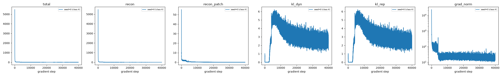
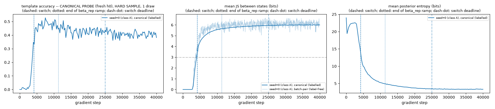
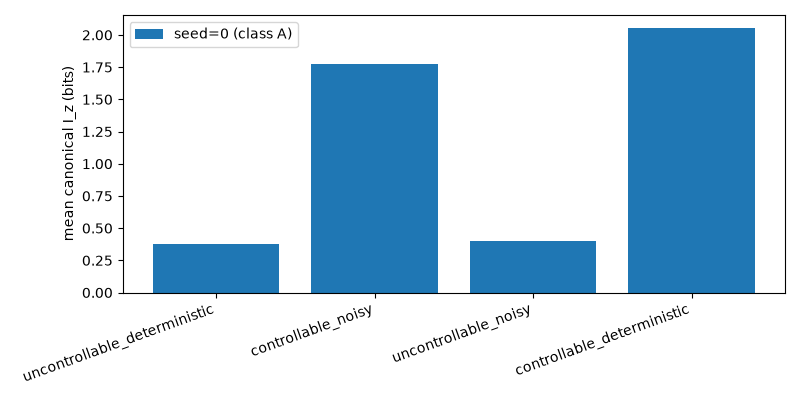
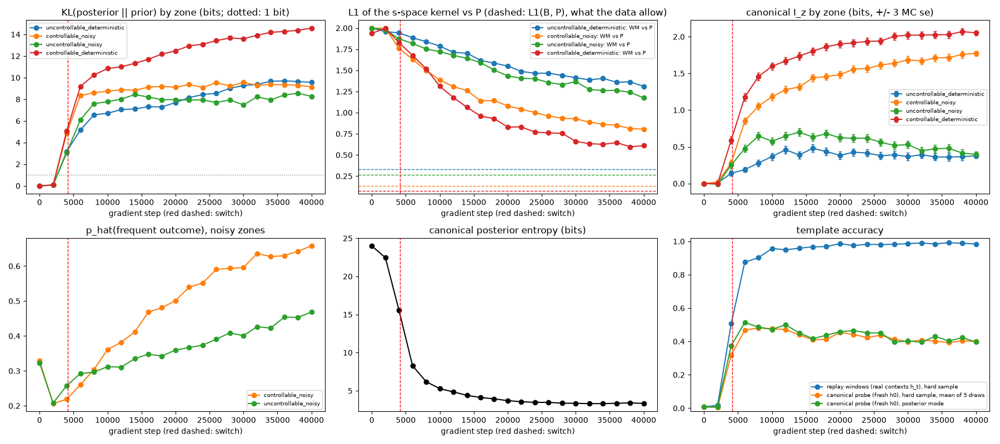
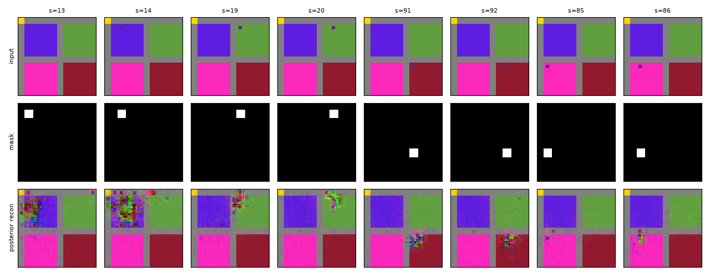

# E3 -- world-model run report (grid12x12__4zones__pair-experimental__worldmodel-mini_long__seed00__20260925T223445Z)

Generated by `experiments/E3_worldmodel_4zones/run_mini.py`, seeds [0] (classes ['A']). Run directories: `grid12x12__4zones__pair-experimental__worldmodel-mini_long__seed00__20260925T223445Z`.

Verdict rules: MC-based checks use a 3-standard-error margin; an ordering whose gap is within 3 combined standard errors is "non concluant", never OK. If the template accuracy (replay windows (real contexts h_t), hard sample) is below 0.5, every indicator built on decoded images or on the posterior's discrimination (s-space kernel, L1, T4 preview, ghosts, D1, D2) is reported as "non évaluable (mécanique en échec)".

**Template accuracy -- what each number measures.** Nearest-template matching of a DECODED image against the 144 renders. *Replay*: windows of the replay buffer unrolled with real contexts h_t, z_t a hard straight-through sample of the posterior (the calibration criterion C-a). *Canonical probe*: every state's render encoded from the learned initial state h0 (fresh-episode context), z a hard sample (mean of 5 draws) or the posterior mode. h0 is only ever seen at the start of a replay window, so the canonical numbers are expected to be lower.

## Loss curves (per term)

Reconstruction is summed over channels and pixels of each image and averaged over batch x time; KL terms are exact, summed over latent variables, in nats. `recon_patch` is diagnostic only (unweighted error on the masked patch, same aggregation), not part of the loss. `grad_norm`: global gradient norm, before any clipping.

## Separation between states along training

## Canonical I_z by zone type

## Seed 0 (class A)

### Training procedure

Weights: recon x1 (patch weight w_patch=10 inside the mask); kl_dyn x0.5 from step 0; kl_rep 0 until the switch, then ramped linearly to x0.1 over 7170 steps; recon_patch x0 (diagnostic). 40000 gradient steps.

Posterior estimator: probabilities until the label-free batch-pair JS exceeded 3.0 bits on 5 consecutive evaluations (every 50 steps, from step 500), then straight-through. **Effective switch step: 4151; deadline 25000 (absolute); margin (deadline - switch step): 20849 steps.** Learning rate 0.001 until the switch, then 0.0001 (changed at step 4151); global gradient-norm clipping: none; collapse guard after the switch: batch-pair JS < 1.0 bits on 5 consecutive evaluations.

Environment: device `cpu`, torch 2.14.0+cpu, CUDA None, 6 threads, TF32 matmul/cuDNN False/False, commit `d74841661e92ac17d88544c2b45426b5cd6b093e` (working tree modified) -- bit-exact only on the same machine, device and number of threads.

| term | start (first 50 steps) | end (last 50 steps) |
|---|---|---|
| total | 1500.7773 | 2.5152 |
| recon | 1500.4748 | 1.0426 |
| recon_patch | 15.2125 | 0.0695 |
| kl_dyn | 0.6050 | 2.4542 |
| kl_rep | 0.6050 | 2.4542 |

### Training diagnostics

Raw values: `diagnostics.jsonl` in the seed's run directory (one line per point).

Expected shapes, fixed in advance (between the first diagnostic at or after the switch and the last one):

| check | first | last | verdict |
|---|---|---|---|
| KL decreasing to < 1 bit (controllable_deterministic) | 9.1784 | 14.5845 | non conforme |
| KL decreasing to < 1 bit (uncontrollable_deterministic) | 5.1496 | 9.5623 | non conforme |
| L1(WM, P) decreasing toward L1(B, P) = 0.329 (uncontrollable_deterministic) | 1.8855 | 1.3099 | conforme |
| L1(WM, P) decreasing toward L1(B, P) = 0.135 (controllable_noisy) | 1.6323 | 0.8057 | conforme |
| L1(WM, P) decreasing toward L1(B, P) = 0.266 (uncontrollable_noisy) | 1.8173 | 1.1742 | conforme |
| L1(WM, P) decreasing toward L1(B, P) = 0.073 (controllable_deterministic) | 1.6769 | 0.6101 | conforme |
| I_z decreasing (uncontrollable_deterministic) | 0.1900 | 0.3774 | non conforme |
| I_z increasing (controllable_deterministic) | 1.1767 | 2.0522 | conforme |

### Template accuracy (final)

| what is decoded | accuracy |
|---|---|
| replay windows (real contexts h_t), hard sample | **0.9844** |
| canonical probe (fresh h0), hard sample, mean of 5 draws | **0.4000** |
| canonical probe (fresh h0), posterior mode | **0.3958** |

z-only linear probe (every replay posterior): train accuracy **0.9932**, test accuracy **0.9835** (n_train=15975, n_test=3993)

### Collapse diagnostics

- I(z; s) over the canonical posteriors (uniform over 144 states): **6.9496 bits** (MC se 0.0493; ceiling log2(144) = 7.1699; ~0 = collapse)
- Mean posterior entropy, canonical probe: **3.3276 bits**; replay (all 19968 posteriors): **2.6021 bits** (ceiling n_vars x log2(n_classes) = 24.0)

### I_z canonical (mean +/- std over states, per zone; MC se of the zone mean)

| zone | mean I_z | std I_z | MC se of the mean |
|---|---|---|---|
| uncontrollable_deterministic | 0.3774 | 0.1356 | 0.0118 |
| controllable_noisy | 1.7734 | 0.3956 | 0.0113 |
| uncontrollable_noisy | 0.3979 | 0.1711 | 0.0120 |
| controllable_deterministic | 2.0522 | 0.3582 | 0.0111 |

### KL(posterior || prior) by zone (canonical probe, mean over actions, bits)

| zone | mean KL (bits) |
|---|---|
| corridor | 11.2144 |
| uncontrollable_deterministic | 9.5623 |
| controllable_noisy | 9.1407 |
| controllable_deterministic | 14.5845 |
| uncontrollable_noisy | 8.2728 |

### L1 of the s-space kernel vs P (true) and vs the tabular twin B, per zone; L1(B, P) = what the data allow

| zone | L1(WM, P) | L1(WM, B) | L1(B, P) |
|---|---|---|---|
| uncontrollable_deterministic | 1.3099 | 1.2362 | 0.3286 |
| controllable_noisy | 0.8057 | 0.7828 | 0.1353 |
| uncontrollable_noisy | 1.1742 | 1.1276 | 0.2662 |
| controllable_deterministic | 0.6101 | 0.6026 | 0.0735 |

### p_hat(frequent outcome) preview (T4 preview) -- noisy zones

| zone | mean p_hat(frequent outcome) |
|---|---|
| controllable_noisy | 0.6578 |
| uncontrollable_noisy | 0.4686 |

### Ghost rate (mean over all (s, a) pairs)

**0.0016**

### Context dispersion (mean abs discrepancy vs canonical I_z): **0.1207**

### D1 (alpha_app, local and global)

Contrast accepted only if |I_L' - I_L| > max(0.25 bit, 3 x combined MC se). alpha_app per state of the own zone with its standard error (error propagation); a value outside [0, 1] by more than 3 se is an ANOMALY, listed and never averaged; the others: mean over states +/- 3 sd/sqrt(n).

| own zone L | target zone L' | I_L' - I_L | threshold | accepted | local: mean [interval] (n kept / n) | global: mean [interval] (n kept / n) | anomalies (local; global) |
|---|---|---|---|---|---|---|---|
| uncontrollable_deterministic | controllable_noisy | 1.3960 | 0.2500 | yes | 0.3167 [0.2303, 0.4032] (23/25) | 0.6861 [0.5206, 0.8516] (14/25) | s=61: 1.35+/-0.04, s=65: 1.36+/-0.04; s=14: 1.21+/-0.04, s=15: 1.24+/-0.04, s=16: 1.19+/-0.04, s=26: 1.20+/-0.04, s=27: 1.19+/-0.04, s=28: 1.23+/-0.04, s=29: 1.22+/-0.05, s=40: 1.23+/-0.04, s=53: 1.20+/-0.04, s=64: 1.37+/-0.05, s=65: 1.34+/-0.04 |
| uncontrollable_deterministic | uncontrollable_noisy | 0.0205 | 0.2500 | no | undefined | undefined | - |
| uncontrollable_deterministic | controllable_deterministic | 1.6748 | 0.2500 | yes | 0.2948 [0.1495, 0.4401] (22/25) | 0.7786 [0.7239, 0.8334] (25/25) | s=52: -0.17+/-0.04, s=61: 1.14+/-0.03, s=65: 1.10+/-0.03; none |
| controllable_noisy | uncontrollable_deterministic | -1.3960 | 0.2500 | yes | 0.4755 [0.3498, 0.6012] (21/25) | 0.1865 [-0.0211, 0.3941] (13/25) | s=55: -0.26+/-0.05, s=57: -0.22+/-0.04, s=67: -0.26+/-0.04, s=68: -0.24+/-0.05; s=21: -0.15+/-0.05, s=22: -0.27+/-0.05, s=33: -0.26+/-0.05, s=34: -0.24+/-0.05, s=35: -0.24+/-0.05, s=45: -0.29+/-0.04, s=46: -0.23+/-0.05, s=47: -0.30+/-0.05, s=57: -0.20+/-0.05, s=58: -0.34+/-0.05, s=59: -0.28+/-0.05, s=67: -0.34+/-0.05 |
| controllable_noisy | uncontrollable_noisy | -1.3755 | 0.2500 | yes | 0.2731 [0.0815, 0.4646] (15/25) | -0.1030 [-, -] (1/25) | s=43: -0.17+/-0.04, s=44: -0.19+/-0.04, s=55: -0.35+/-0.04, s=56: -0.41+/-0.04, s=57: -0.36+/-0.04, s=59: -0.13+/-0.04, s=67: -0.37+/-0.04, s=68: -0.39+/-0.04, s=69: -0.29+/-0.04, s=70: -0.30+/-0.04; s=19: -0.26+/-0.04, s=20: -0.27+/-0.04, s=21: -0.34+/-0.04, s=22: -0.37+/-0.04, s=23: -0.42+/-0.04, s=31: -0.41+/-0.04, s=32: -0.24+/-0.04, s=33: -0.29+/-0.04, s=34: -0.42+/-0.04, s=35: -0.16+/-0.04, s=43: -0.30+/-0.04, s=44: -0.33+/-0.04, s=45: -0.34+/-0.04, s=46: -0.28+/-0.04, s=47: -0.13+/-0.04, s=55: -0.29+/-0.04, s=56: -0.30+/-0.04, s=57: -0.36+/-0.04, s=58: -0.27+/-0.04, s=67: -0.32+/-0.04, s=68: -0.33+/-0.04, s=69: -0.37+/-0.04, s=70: -0.30+/-0.04, s=71: -0.17+/-0.04 |
| controllable_noisy | controllable_deterministic | 0.2788 | 0.2500 | yes | 1.0218 [0.4798, 1.5637] (12/25) | 0.4274 [-0.2137, 1.0685] (17/25) | s=19: -1.35+/-0.24, s=20: -1.16+/-0.23, s=21: -2.21+/-0.26, s=22: -2.39+/-0.27, s=23: -4.00+/-0.34, s=31: -1.54+/-0.26, s=32: -1.99+/-0.26, s=34: -0.74+/-0.20, s=35: -2.12+/-0.24, s=46: -2.04+/-0.24, s=47: -1.03+/-0.20, s=68: 1.71+/-0.21, s=69: 1.82+/-0.21; s=20: -1.09+/-0.25, s=23: -1.37+/-0.23, s=31: -2.58+/-0.30, s=33: -0.99+/-0.22, s=43: -0.84+/-0.26, s=44: -0.81+/-0.24, s=45: -0.96+/-0.22, s=46: -0.99+/-0.24 |
| uncontrollable_noisy | uncontrollable_deterministic | -0.0205 | 0.2500 | no | undefined | undefined | - |
| uncontrollable_noisy | controllable_noisy | 1.3755 | 0.2500 | yes | 0.0233 [-0.0519, 0.0986] (21/25) | 0.8314 [0.7007, 0.9621] (2/25) | s=115: -0.15+/-0.04, s=128: -0.18+/-0.05, s=129: -0.19+/-0.04, s=130: -0.15+/-0.04; s=91: 1.30+/-0.04, s=92: 1.32+/-0.04, s=93: 1.27+/-0.04, s=94: 1.32+/-0.04, s=95: 1.37+/-0.04, s=103: 1.35+/-0.04, s=105: 1.36+/-0.04, s=106: 1.35+/-0.04, s=115: 1.43+/-0.04, s=116: 1.37+/-0.04, s=117: 1.37+/-0.04, s=118: 1.34+/-0.04, s=119: 1.42+/-0.04, s=127: 1.35+/-0.04, s=128: 1.37+/-0.04, s=129: 1.37+/-0.04, s=130: 1.38+/-0.04, s=131: 1.40+/-0.04, s=139: 1.31+/-0.04, s=140: 1.39+/-0.04, s=141: 1.42+/-0.04, s=142: 1.24+/-0.04, s=143: 1.41+/-0.04 |
| uncontrollable_noisy | controllable_deterministic | 1.6543 | 0.2500 | yes | 0.0116 [-0.0496, 0.0728] (20/25) | 0.5429 [0.3329, 0.7530] (25/25) | s=105: -0.16+/-0.04, s=107: -0.14+/-0.04, s=118: -0.11+/-0.03, s=119: -0.12+/-0.04, s=142: -0.14+/-0.03; none |
| controllable_deterministic | uncontrollable_deterministic | -1.6748 | 0.2500 | yes | 0.4145 [0.2289, 0.6000] (24/25) | 0.4259 [0.3670, 0.4849] (25/25) | s=111: -0.14+/-0.03; none |
| controllable_deterministic | controllable_noisy | -0.2788 | 0.2500 | yes | 0.0664 [-0.6767, 0.8096] (7/25) | 0.2137 [-0.3267, 0.7542] (18/25) | s=85: -1.04+/-0.24, s=86: -0.82+/-0.21, s=87: -0.90+/-0.21, s=88: -0.87+/-0.24, s=89: -1.14+/-0.22, s=97: -1.15+/-0.23, s=98: -0.95+/-0.20, s=99: -0.81+/-0.20, s=100: -1.12+/-0.21, s=101: -1.15+/-0.21, s=110: -0.95+/-0.22, s=111: -0.97+/-0.21, s=113: -0.71+/-0.21, s=125: 1.78+/-0.22, s=133: 4.04+/-0.30, s=134: 1.92+/-0.22, s=136: 1.93+/-0.23, s=137: 2.59+/-0.26; s=86: -0.73+/-0.23, s=110: -0.98+/-0.22, s=113: -0.80+/-0.21, s=122: -0.84+/-0.24, s=123: -0.87+/-0.27, s=124: -0.72+/-0.22, s=136: 2.10+/-0.24 |
| controllable_deterministic | uncontrollable_noisy | -1.6543 | 0.2500 | yes | 0.2066 [-0.0272, 0.4404] (12/25) | 0.2659 [-0.0021, 0.5338] (13/25) | s=85: -0.15+/-0.04, s=86: -0.18+/-0.04, s=87: -0.13+/-0.04, s=88: -0.12+/-0.04, s=89: -0.11+/-0.03, s=97: -0.19+/-0.03, s=98: -0.16+/-0.03, s=99: -0.11+/-0.03, s=100: -0.15+/-0.03, s=101: -0.14+/-0.03, s=110: -0.17+/-0.04, s=111: -0.14+/-0.03, s=112: -0.13+/-0.03; s=85: -0.20+/-0.04, s=86: -0.13+/-0.03, s=87: -0.23+/-0.04, s=88: -0.21+/-0.04, s=89: -0.16+/-0.03, s=97: -0.21+/-0.03, s=99: -0.25+/-0.03, s=100: -0.17+/-0.03, s=101: -0.12+/-0.03, s=109: -0.13+/-0.03, s=110: -0.16+/-0.03, s=111: -0.12+/-0.03 |

### D2 -- neighbour JS distance, boundary vs within-zone

- boundary (different category) mean JS: **3.6609**
- within-zone (same category) mean JS: **2.3821**

## Expected-shape checklist (spec: "formes attendues seulement")

| # | check | seed (class) | expected | observed | verdict |
|---|---|---|---|---|---|
| 1 | I_z(conveyor) < I_z(controllable-det) | 0 (A) | gap > 3 x combined se | 0.3774 vs 2.0522 (gap 1.6748, combined se 0.0161) | OK |
| 2 | 0 <= I_z <= log2(5), per state within 3 MC se | 0 (A) | 0 violations | 0 violation(s) / 144 | OK |
| 3 | template accuracy (replay windows (real contexts h_t), hard sample) high | 0 (A) | >= 0.5 (mini; calibration's C-a is 0.99) | 0.9844 | OK |
| 4 | alpha_app defined only on accepted contrasts; anomalies listed | 0 (A) | contrast > max(0.25, 3 se) | 10/12 pairs accepted, 170 anomalous state value(s) | OK |